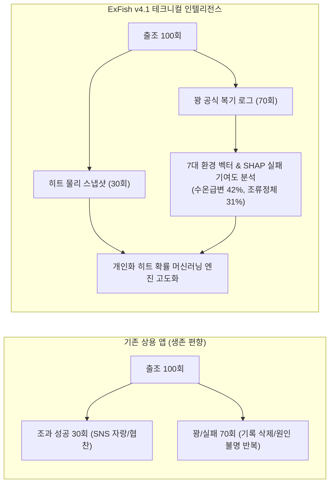
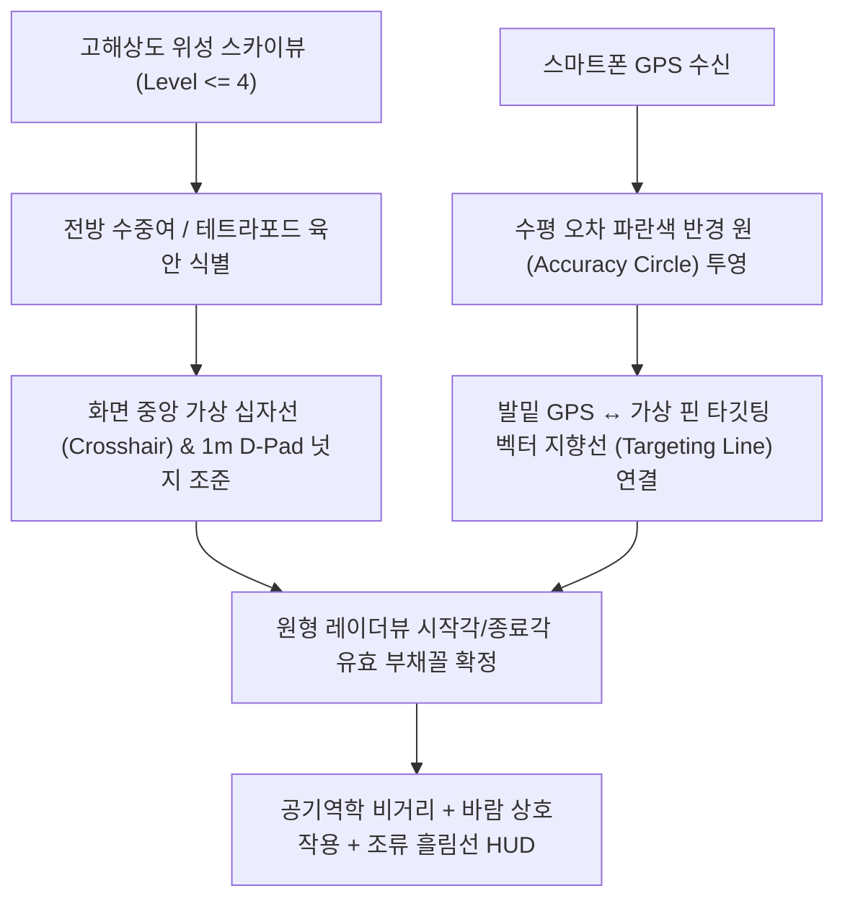
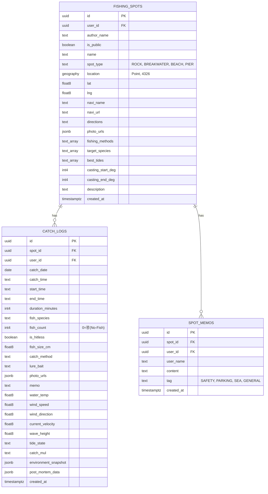

# 🎣 ExFish 웹 플랫폼 세부 설계 사양서 (v4.1 최종 확정판)
> **슬로건**: *"ex-gf, ex-wife, and ex-fish. 떠나버린 물고기를 기리며..."*  
> **버전**: Version 4.1 (Industrial-Grade Architecture & Engineering Specification)  
> **최종 개정일**: 2026년 10월 21일  
> **공개 저장소**: [https://github.com/tlogger/espFish](https://github.com/tlogger/espFish)  
> **라이브 서비스**: [https://tlogger.github.io/espFish/](https://tlogger.github.io/espFish/)  
> **문서 상태**: 프로덕션 배포용 엔지니어링 표준 사양 (Approved by @reviewer)

---

## 0. 공학 표준 기호 정의표 (Nomenclature Table)

본 사양서 전반에서 사용하는 물리량, 수학 기호, SI 단위 및 낚시 현장 관용 단위를 아래와 같이 정의합니다.

| 기호 (Symbol) | 물리량 명칭 (Quantity) | SI 단위 | 현장 관용 단위 | 기본값 / 기준 파라미터 |
| :--- | :--- | :---: | :---: | :--- |
| $D_{\text{cast}}$ | 지상 캐스팅 실효 비거리 | $\text{m}$ | $\text{m}$ | $55.0\text{ m}$ (기준 비거리) |
| $L_{\text{feet}}$ | 낚싯대(로드) 전장 전장 규격 | $\text{m}$ | $\text{ft}$ (피트) | $8.6\text{ ft}$ (표준 에깅/워킹 루어대) |
| $W$ | 루어·채비 총 자중 (무게) | $\text{kg}$ | $\text{g}$ (그램), $\text{oz}$ | 장르별 상이 ($0.5\text{g} \le W \le 200\text{g}$) |
| $W_{\text{opt}}$ | 로드 파워별 최적 스위트스팟 무게 | $\text{kg}$ | $\text{g}$ (그램) | M파워 기준 $22.0\text{g}$ |
| $\eta_{\text{power}}$ | 로드 블랭크 탄성 에너지 축적 효율 | 무차원 ($0 \sim 1$) | $\%$ | 최적 부하 시 $1.00$ ($100\%$) |
| $\sigma_{\text{under}}$ | 저부하(Underload) 감쇄 표준편차 | 무차원 | 무차원 | $0.60$ |
| $\sigma_{\text{over}}$ | 과부하(Overload) 붕괴 표준편차 | 무차원 | 무차원 | $0.38$ |
| $\text{PE}$ | 원줄 합사(Braid Line) 호수 규격 | 무차원 (Gou) | 호 (PE) | $1.0\text{호}$ (직경 $\approx 0.165\text{mm}$) |
| $K_{\text{line}}$ | 원줄 공기역학 항력 감쇄 계수 | 무차원 | 무차원 | PE 1.0호 기준 $1.00$ |
| $K_{\text{wind}}$ | 풍향·풍속 벡터 비거리 보정 계수 | 무차원 | $\%$ | $0.65 \sim 1.35$ ($-35\% \sim +35\%$) |
| $v_{\text{sink}}$ | 루어 수중 정지 종단 침강 속도 | $\text{m/s}$ | $\text{m/s}$, $\text{sec/m}$ | 납 메탈 기준 $0.28\sqrt{W}$ |
| $C_{\text{lure}}$ | 루어 유체역학 형상 계수 | 무차원 | 무차원 | 메탈(1.00), 에기(0.25), 텅스텐(1.25) |
| $v_{\text{eff}}$ | 조류 원줄 양력 감쇄 유효 침강 속도 | $\text{m/s}$ | $\text{m/s}$ | $0.15 \sim 2.80\text{ m/s}$ (클램핑) |
| $V_{\text{current}}$ | 해류/조류 표층 유속 | $\text{m/s}$ | $\text{m/s}$, $\text{knot}$ | $1\text{ knot} \approx 0.514\text{ m/s}$ |
| $H$ | 캐스팅 착수 지점 수심 | $\text{m}$ | $\text{m}$ | 수심 등심선 보간치 ($-5\text{m} \sim -50\text{m}$) |
| $T_{\text{bottom}}$ | 채비 바닥 안착 소요 시간 (폴링 카운트) | $\text{s}$ (초) | $\text{초}$ | $H / v_{\text{eff}}$ |
| $D_{\text{drift}}$ | 침강 중 조류에 의한 수평 흘림 거리 | $\text{m}$ | $\text{m}$ | $V_{\text{current}} \times T_{\text{bottom}}$ |
| $\hat{H}(t, \mathbf{x})$ | 시공간 하이브리드 보정 조위 수위 | $\text{cm}$ | $\text{cm}$ | 국립해양조사원(KHOA) 조위면 기준 |
| $H_{\text{harmonic}}$ | 4대 조화분조 합성 천문조위 | $\text{cm}$ | $\text{cm}$ | $M_2, S_2, K_1, O_1$ 분조 합성 |
| $\Delta H_{\text{obs}}$ | KHOA 관측소 실측 잔차 (Observed Error) | $\text{cm}$ | $\text{cm}$ | $H_{\text{obs}}(t_0) - H_{\text{harmonic}}(t_0)$ |
| $\lambda$ | 조위 잔차 시간 지수감쇄 계수 | $\text{h}^{-1}$ | $\text{h}^{-1}$ | $\lambda = \frac{\ln 2}{6} \approx 0.1155\text{ h}^{-1}$ (반감기 6h) |
| $R$ | 관측소-포인트 간 대권 거리 | $\text{km}$ | $\text{km}$ | Haversine 공식 산출치 |
| $R_0$ | 조위 잔차 공간 가우스 상관 거리 | $\text{km}$ | $\text{km}$ | $35.0\text{ km}$ ($2R_0 = 70\text{ km}$ 임계) |
| $T_{\text{escape}}$ | 갯바위 들물 탈출 골든타임 | $\text{min}$ (분) | 분 (min) | $45 \sim 120\text{분}$ (조차 가변) |
| $\Delta H_{\text{tide}}$ | 일일 최대 조차 (만조위 - 간조위) | $\text{m}$ | $\text{m}$, $\text{cm}$ | 서해 대조기 기준 최대 $8.5\text{m}$ |
| $\mathbf{x}$ | 7대 환경 특성 입력 벡터 | 혼합 | 혼합 | 수온, 조류, 풍향, 기압, 파고 등 7개 차원 |
| $\phi_j$ | $j$번째 환경 인자의 SHAP 한계 기여도 | 무차원 | $\%$ | 로지스틱 회귀 logit 기여분 |

---

## 1. 프로젝트 개요 및 브랜드 철학

### 1.1 플랫폼 비전: 실패의 과학적 데이터 복기
기존 상용 낚시 앱(어신, 물반고기반, Fishbrain 등)은 1% 미만의 대형어 조과 사진과 협찬 광고에 치우친 **생존 편향(Survivorship Bias)**의 한계를 지닙니다. 그러나 실제 앵글러의 출조 중 60~70%는 입질 한 번 받지 못하는 **'꽝(Skunk/No-Fish)'**입니다.

ExFish는 *"ex-gf, ex-wife, and ex-fish. 떠나버린 물고기를 기리며..."*라는 슬로건 아래, 실패한 출조를 단순 삭제하거나 망각하는 대신 **당시의 정량적 물리량(수온, 조석, 유속, 풍향·풍속, 채비, 기압)**으로 박제하여 실패 원인을 과학적으로 복기하는 **'프로 앵글러 전용 테크니컬 피싱 인텔리전스 계측기'**입니다.



### 1.2 핵심 기술 스택
- **프론트엔드 코어**: React 19 + TypeScript + Tailwind CSS v4 + Vite v8
- **지도 엔진**: 카카오 맵 JS SDK (`react-kakao-maps-sdk`) — 50cm급 고해상도 위성 실사 항공사진, 커스텀 벡터 오버레이
- **사운드 합성 엔진**: Web Audio API 기반 무의존 순수 듀얼톤($880\text{Hz} \rightarrow 440\text{Hz}$) 경보 합성기
- **백그라운드 안전장치**: Screen Wake Lock API (`navigator.wakeLock`) + Web Notifications API
- **차트 및 데이터 시각화**: Recharts 기반 반응형 SVG 면적/곡선 차트
- **해양 데이터 파이프라인**:
  - 국립해양조사원(KHOA) 바다누리 53개 조위관측소 실시간 API 및 4대 조화분조
  - Open-Meteo Marine & Weather API (표층수온, 유의파고, 파주기, 풍향/풍속, 기압)
  - KHOA 국가해양격자 4대 권역 벡터 수심 등심선(5m/10m/20m/50m) GeoJSON
- **스토리지 및 인증**: Supabase (PostgreSQL 15 + PostGIS + RLS) + IndexedDB (초경량 JSON 오프라인 캐시) + OAuth 2.0 (구글, 애플, 네이버, 카카오)

---

## 2. 지도 엔진 및 가상 조준경 물리 HUD 명세



### 2.1 3대 지도 모드 전환
1. **🗺️ 일반 지도 (`ROADMAP`)**: 주간에 항만 지명, 주차장, 도로를 직관적으로 파악.
2. **🛰️ 고해상도 스카이뷰 (`HYBRID`)**: 50cm급 실사 항공사진으로 갯바위 여밭, 물골, 간출암, 테트라포드 발판을 실사로 정밀 탐색.
3. **🌙 야간 다크 모드 (`DARK`)**: 캔버스 톤 반전 및 저조도 야간 시야 보호 테마 적용 (`localStorage` 영구 보존).

### 2.2 가상 십자선 조준경 (Virtual Crosshair) & 1m D-Pad 정밀 조준
- **개념 재정의**: 스마트폰 GPS의 5~15m 수평 오차(CEP)를 고려하여, 1m D-Pad는 발밑 GPS 수정이 아닌 **"위성 실사 영상에서 육안 식별되는 전방 수중여/간출암/방파제 끝선을 원격 조준경처럼 미세 타깃팅하는 도구"**로 동작.
- **GPS 정확도 원 시각화**: 기기 수신 정확도(`coords.accuracy`)를 반투명 청색 원(`accuracyCircle`, fillOpacity: 0.15, strokeColor: `#3B82F6`)으로 지도상에 실시간 투영.
- **타깃팅 벡터 지향선 (Targeting Line)**:
  - 앵글러의 현재 실측 위치(GPS 수신 좌표)와 원격 가상 조준경 핀(Virtual Crosshair Target) 사이에 **황금색 점선 지향선(Golden Dash Vector Line, strokeWeight: 2, strokeColor: `#F59E0B`, strokeStyle: `shortdash`)**을 실시간 연결.
  - 선 중앙에 **`내 위치로부터 거리: XX.X m | 방위각: XXX°`** 플로팅 거리 뱃지(`CustomOverlay`)를 투영하여, 앵글러가 서 있는 발판과 공략하려는 수중여 사이의 실측 이격 거리를 직관적으로 인지.
- **마커 2D 드래깅 및 1m 넛지**:
  - 작성자 본인 포인트일 때만 **`[🎯 위치 미세조정]`** 컨트롤 활성화.
  - 최고 배율(Level 1) 위성 스카이뷰로 자동 전환되며, 지도 위 핀을 드래그하거나 동서남북 1m D-Pad($\Delta\text{lat} \approx 0.000009^\circ$, $\Delta\text{lng} \approx 0.000011^\circ$)로 픽셀 단위 넛지 이동 후 저장.

### 2.3 원형 레이더뷰 유효 캐스팅 부채꼴 섹터
- **시작각 및 종료각 지정**: 방위 문자열(N, NE 등) 대신 각도기 다이얼/슬라이더를 통해 유효 공략 각도(예: $45^\circ \sim 135^\circ$)를 지정.
- **레이더 가이드 라인**: 시작각(녹색 점선)과 종료각(시안색 점선)이 최대 사거리까지 뻗어나가며, 호 중심에는 거리 눈금 뱃지 표출.
- **전방위(ALL) 폐지**: 실제 갯바위/방파제는 배후 육지가 존재하므로 전방위 지정을 제거하고 부채꼴 각도로 표준화.

### 2.4 실시간 바람·조류 상호작용 물리 HUD
- **바람 벡터 ($W_{\text{to}} = (W_{\text{from}} + 180^\circ) \bmod 360^\circ$)와 캐스팅 각도($\theta_{\text{cast}}$)의 각도차($\Delta\theta$) 판정**:
  - **등바람 (Tailwind, $\Delta\theta \le 45^\circ$)**: 에메랄드 그린 화살표, **비거리 최대 $+35\%$ 증가** 시각화.
  - **맞바람 (Headwind, $\Delta\theta \ge 135^\circ$)**: 로즈 레드 화살표, **비거리 최대 $-35\%$ 감소** 시각화.
  - **옆바람 (Crosswind)**: 앰버 골드 화살표, **'옆바람 줄날림 주의'** 경고 및 탄착 유효호 수축.
- **실시간 조류 흘림선 (Drift Path)**: 착수 지점으로부터 실시간 유속($V_{\text{current}}$)과 유향에 따른 채비 흘림 궤적을 점선 화살표로 투영.

---

## 3. 공기역학 채비 및 로드 탄성 비거리 계산 엔진

ExFish는 단순 추정이 아닌, 낚싯대의 블랭크 탄성 에너지 축적과 공기역학 항력 역학에 기반한 통합 비거리 공식을 적용합니다.

### 3.1 통합 캐스팅 비거리 공식
$$D_{\text{cast}} = 55\text{ m} \times K_{\text{length}} \times \eta_{\text{power}}(W) \times K_{\text{line}}(\text{PE}) \times K_{\text{wind}}$$

```
[비거리 결정 파이프라인]
  로드 전장 지렛대 계수: K_length = (Length / 8.6)^0.65
                    ×
  비대칭 탄성 효율:     η_power = exp( - (ln W - ln W_opt)^2 / (2 * σ^2) )
                    ×
  원줄 합사 공기항력:   K_line = (1.0 / PE)^0.22
                    ×
  풍향/풍속 벡터 보정:   K_wind (등바람 +35% ~ 맞바람 -35%)
```

### 3.2 로드 파워별 최적 스위트스팟 ($W_{\text{opt}}$) 규격표
| 로드 파워 (Power) | 최적 무게 ($W_{\text{opt}}$) | 권장 허용 무게 | 주요 대상 장르 |
| :--- | :---: | :---: | :--- |
| **UL (울트라라이트)** | **3 g** | 1 ~ 7 g | 볼락, 아징(전갱이) 지그헤드 |
| **L (라이트)** | **7 g** | 3 ~ 12 g | 호래기, 우럭 라이트 다운샷 |
| **ML (미디엄라이트)** | **14 g** | 7 ~ 21 g | 주꾸미, 갑오징어 소형 에기 |
| **M (미디엄 표준)** | **22 g** | 10 ~ 35 g | 무늬오징어 에깅 3.5호, 광어 다운샷 |
| **MH (미디엄헤비)** | **35 g** | 18 ~ 50 g | 농어 미노우, 중형 삼치 스푼 |
| **H (헤비)** | **60 g** | 30 ~ 90 g | 쇼어지깅(방어/부시리 메탈지그) |
| **XH (엑스트라헤비)** | **100 g** | 50 ~ 150 g+ | 서프 원투 낚시, 헤비 플러깅 |

### 3.3 로드 길이 계수 ($K_{\text{length}}$)
$$K_{\text{length}} = \left(\frac{L_{\text{feet}}}{8.6}\right)^{0.65}$$
- $6.6\text{ft}$: $\times 0.84$ (선상/내항)
- $8.6\text{ft}$: $\times 1.00$ (에깅/워킹 표준)
- $10.6\text{ft}$: $\times 1.15$ (서프 장타)
- $14.8\text{ft}$ (4.5m 서프): $\times 1.42$ (원투대)

### 3.4 비대칭 스플릿 로그-가우시안 로드 탄성 효율 곡선 ($\eta_{\text{power}}$)
기존의 대칭 정규분포 가우시안 모델은 과부하 시 로드가 버티지 못하고 탄성이 붕괴하는 현상을 설명하지 못했습니다. 실제 카본 블랭크의 비대칭 물리 특성을 반영한 **스플릿 로그-가우시안(Split Log-Gaussian) 모델**을 도입합니다.

$$\eta_{\text{power}}(W) = \begin{cases}
\exp\left( - \frac{(\ln W - \ln W_{\text{opt}})^2}{2 \sigma_{\text{under}}^2} \right), & W < W_{\text{opt}} \quad (\sigma_{\text{under}} = 0.60, \text{ 저부하 탄성 미달}) \\
\exp\left( - \frac{(\ln W - \ln W_{\text{opt}})^2}{2 \sigma_{\text{over}}^2} \right), & W \ge W_{\text{opt}} \quad (\sigma_{\text{over}} = 0.38, \text{ 과부하 탄성 붕괴})
\end{cases}$$

#### 안전 가드레일 및 한계 클램핑:
1. **극소 자중 하한 클램핑 ($W < 0.5\text{g}$)**: 관성 모멘트 부재로 인한 비행 불가 판정, $\eta_{\text{power}} = 0.05$ 강제 클램핑.
2. **블랭크 파손 경고 가드레일 ($W > 2.0 \times W_{\text{opt}}$)**:
   - 로드 허용 한계 초과로 블랭크 팁 파손(Blank Fracture Risk) 위험 감지.
   - HUD 및 상세 패널에 `[⚠️ OVERLOAD 로드 파손 주의]` 플래싱 경고 표출 및 탄성 효율 $\eta_{\text{power}} \le 0.15$ 급락 반영.

---

## 4. 수중 침강(폴링) 및 조류 흘림 물리 엔진

루어가 수면에 착수한 직후 바닥(해저면)까지 도달하는 시간과 조류 밀림을 유체역학 종단 속도와 원줄 양력 감쇄 모델로 계산합니다.

```
착수 지점 (수면)
    │  \
    │   \  조류에 밀리는 실제 궤적
 수심(H)  \  유효 침강 속도 (veff)
    │      \
    ↓        ↘
해저 바닥 ─────→ [착저 지점: 조류 방향으로 Ddrift 만큼 밀림]
```

### 4.1 루어 유체역학 형상 계수 ($C_{\text{lure}}$) 도입 수중 종단 속도 ($v_{\text{sink}}$)
동일한 무게라도 텅스텐 지그와 오징어 에기의 침강 속도는 최대 5배 차이가 납니다. 루어 형상에 따른 항력 계수를 반영합니다:

$$v_{\text{sink}} \approx C_{\text{lure}} \times 0.28 \times \sqrt{W\text{ (g)}} \quad (\text{m/s}) \quad [0.15\text{ m/s} \le v_{\text{sink}} \le 2.80\text{ m/s} \text{ 클램핑}]$$

#### 루어 유체역학 형상 계수 ($C_{\text{lure}}$) 규격표
| 루어 카테고리 (Lure Type) | 형상 계수 ($C_{\text{lure}}$) | 침강 특성 및 유체역학적 근거 | 대표 사용 장르 |
| :--- | :---: | :--- | :--- |
| **텅스텐 마이크로 지그** | **1.25** | 초고밀도(납 대비 1.7배), 최소 투영 단면적으로 물 저항 최소화 | 아징, 락피시 초원투 |
| **납 메탈지그 / 캐스팅 스푼** | **1.00** | 유선형 메탈 슬림 바디 (기준 표준 계수) | 쇼어지깅, 삼치·방어 |
| **바이브레이션 / 블레이드 루어** | **0.85** | 루어 전면 플랫 헤드 및 회전 블레이드의 수압 저항 | 농어, 광어 바이브 |
| **지그헤드 + 3~4인치 웜** | **0.65** | 웜 꼬리(패들/그럽) 수류 저항으로 인한 감속 폴링 | 우럭, 볼락 지그헤드 |
| **슬로우 피치 지그 / 플랫 메탈** | **0.50** | 비대칭 바디의 슬라이드 및 플러터링 폴링 액션 | 바닥층 락피시, 넙치 |
| **오징어 에기 3.5호 (Egi)** | **0.25** | 침강률 표준 $3.0 \sim 3.5\text{s/m}$, 깃털 날개/싱커 밸런스 저항 | 무늬오징어, 한치 |

### 4.2 조류에 의한 원줄 양력 감쇄 및 유효 침강 속도 ($v_{\text{eff}}$)
조류가 흐르면 원줄(합사)에 수압 저항(Line Drag)이 생겨 루어의 침강을 방해합니다:
$$v_{\text{eff}} = \frac{v_{\text{sink}}}{\sqrt{1 + \left(\frac{V_{\text{current}}}{0.6 \cdot v_{\text{sink}}}\right)^2}}$$

### 4.3 바닥 안착 시간 ($T_{\text{bottom}}$) 및 조류 흘림 거리 ($D_{\text{drift}}$)
- **바닥 안착 소요 시간**:
  $$T_{\text{bottom}} = \frac{H}{v_{\text{eff}}} \quad (\text{초})$$
- **침강 중 조류 흘림 거리**:
  $$D_{\text{drift}} = V_{\text{current}} \times T_{\text{bottom}} \quad (\text{m})$$

### 4.4 HUD 표기 형태
- **지도 착수 뱃지**: `🎯 공략각 65° | 사거리 62m` / `🌊 착수수심 -12m | ⏱️ 바닥 안착: 약 14초 (조류 흘림 +5.8m)` / `로드 8.6ft M (탄성효율 96%) · 에기 3.5호(21g)/PE 0.8호`
- **상세 패널 가이드 표**: 현재 조류 유속을 반영하여 수심 $3\text{m}, 5\text{m}, 8\text{m}, 12\text{m}, 18\text{m}$에서 몇 초를 세고 액션을 시작해야 하는지 실시간 폴링 카운트다운 표 제공.

---

## 5. KHOA 수심 등심선 & 시공간 하이브리드 조위 엔진

### 5.1 KHOA 국가해양격자 벡터 수심 등심선 오버레이 (Dual-Stroke 고대비 규격)
위성 실사 영상의 복잡한 텍스처 위에서 완벽한 시인성을 확보하기 위해 **2중 외곽선(Dual Stroke)** 렌더링 규격을 적용합니다.

```
[2중 외곽선 단면 구조]
  외부 쉴드 스트로크: 5.0px (Deep Black #000000, 불투명도 0.8) ─── 배경 파도 텍스처 차단
    내부 코어 라인:   2.5px (고시인성 네온 컬러) ─────────────── 수심대 식별
```

#### 수심대별 네온 컬러 사양
- **-5 m (간출여/암초 경계)**: **네온 시안 (`#00F0FF`, Neon Cyan)** — 밑걸림 주의 및 여밭 엣지
- **-10 m (브레이크라인/급경사)**: **세이프티 옐로우 (`#FFE600`, Safety Yellow)** — 1차 급심 드롭오프존
- **-20 m (주류대 물골/갯골)**: **네온 마젠타 (`#FF007A`, Neon Magenta)** — 회유성 대형 어종 유영로
- **-50 m (외해 심해선)**: **퓨어 화이트 (`#FFFFFF`, Pure White)** — 외해 심도 경계선

- **지도 컨트롤**: 우상단 **`[🌊 수심선]`** 토글 버튼 탑재.
- **착수 지점 예상 수심 자동 계산 (`estimateDepthAtPoint`)**: 발판 종류(갯바위 급심, 방파제, 백사장 완경사)와 비거리에 따른 수심 경사도 모델로 캐스팅 착수점의 예상 수심을 $-X.X\text{m}$로 자동 보간.

---

### 5.2 KHOA 실측 잔차의 시공간 복합 감쇄 하이브리드 조위 엔진
기존의 시간 감쇄 모델에 공간 상관 거리($R_0 = 35\text{ km}$)를 결합한 **시공간 하이브리드 수식**을 도입합니다.

$$\hat{H}(t, \mathbf{x}) = H_{\text{harmonic}}(t, \mathbf{x}) + \Delta H_{\text{obs}}(t_0, \mathbf{x}_0) \cdot \exp\left(-\lambda (t - t_0)\right) \cdot \exp\left(-\left(\frac{R}{R_0}\right)^2\right) + \Delta H_{\text{meteo}}(t, \mathbf{x})$$

- **$\Delta H_{\text{obs}}(t_0, \mathbf{x}_0) = H_{\text{obs}}(t_0, \mathbf{x}_0) - H_{\text{harmonic}}(t_0, \mathbf{x}_0)$**: 기준 시각 $t_0$에서 Haversine 공식으로 탐색한 가장 가까운 KHOA 조위관측소($\mathbf{x}_0$)의 실시간 실측 잔차.
- **$\exp(-\lambda (t - t_0))$**: 잔차의 시간 감쇄 함수 (반감기 6시간, $\lambda \approx 0.1155\text{ h}^{-1}$).
- **$\exp(-(R / R_0)^2)$**: 공간 가우스 상관 감쇄 함수 ($R_0 = 35.0\text{ km}$).
  - $R \le 10\text{ km}$: 가중치 $\ge 0.92$ (실측 잔차 적극 반영)
  - $R = 35\text{ km}$: 가중치 $0.368$ (완만한 반영)
  - $R \ge 70\text{ km}$: 가중치 $\le 0.018$ (천문조위 및 기상조위로 안전하게 수렴)
- **$\Delta H_{\text{meteo}}(t, \mathbf{x})$**: 역기압 효과 보정 ($(1013.25 - P_t) \times 1.01\text{ cm}$).
- **상세 패널 표시**: 36시간 조위 그래프 상단에 `📍 KHOA [관측소명] (거리 8.4km | 잔차가중 94%) | 시공간 하이브리드 조위 가동중` 실시간 뱃지 표출.

---

## 6. 해양 안전 및 조석 타임라인 명세

### 6.1 갯바위 들물 탈출 골든타임 동적 가변 공식 및 백그라운드 안전장치
고정 90분은 서해 대조기(사리, 조차 8m+) 시 급격한 수위 상승으로 인해 징검다리가 순식간에 침수되어 치명적 고립 사고를 유발합니다. 조차에 연동되는 동적 가변 탈출 공식을 적용합니다.

#### 조차 연동 동적 탈출 골든타임 공식
$$T_{\text{escape}}(\Delta H_{\text{tide}}) = \max\left(45, \; 120 - 70 \times \left(\frac{\Delta H_{\text{tide}} - 2.0}{6.5}\right)\right) \quad (\text{분, min})$$

- **소조기/조금 ($\Delta H_{\text{tide}} \le 2.0\text{m}$)**: $T_{\text{escape}} = 120\text{분}$ (완만한 들물)
- **중조기 ($\Delta H_{\text{tide}} \approx 5.0\text{m}$)**: $T_{\text{escape}} \approx 88\text{분}$
- **대조기/사리 ($\Delta H_{\text{tide}} \ge 8.5\text{m}$ 서해 사리)**: **최소 안전 마진 $50\text{분}$으로 자동 단축** (급격한 유속 및 퇴로 차단 원천 방어)

#### 무중단 백그라운드 안전장치 명세
1. **Screen Wake Lock API (`navigator.wakeLock.request('screen')`)**:
   - 갯바위 진입 모드 및 탈출 타이머 활성화 시 화면 자동 꺼짐을 방지하여 상시 타이머 주시 보장.
2. **Web Notifications API (헤드업 시스템 푸시)**:
   - 스마트폰 화면이 꺼지거나 브라우저가 백그라운드로 전환되어 주머니에 보관된 상태에서도 잔여 시간 30분, 15분, 5분, 0분 시점에 시스템 레벨 진동 및 긴급 철수 푸시 알림 발령.
3. **Web Audio API 합성 비프 경보**:
   - 외부 음원 파일 없이 $880\text{Hz} \rightarrow 440\text{Hz}$ 듀얼톤 비프 경보음 발생(`playEvacuationBeep()`), 원클릭 소리 테스트 및 25초 주기 비프 알람 스위치 지원.

### 6.2 너울(Swell) 위험도 3단계 지수 & 해경 위험예보 자동 감지
- **너울 파괴 에너지 지수**: $\text{Energy} = H_{\text{wave}} \times T_{\text{period}}$
  - $\text{Energy} \ge 12.0$ or $H \ge 2.0\text{m}$: `[🚨 DANGER 진입금지]`
  - $\text{Energy} \ge 7.0$ or $H \ge 1.3\text{m}$: `[⚡ CAUTION 주의요망]`
  - 그 외: `[✅ SAFE 양호]`
- **연안사고 위험예보 자동 감지**: 대조기(사리) 만조 전후 2시간대이거나 너울 파고 위험 시 플래싱 경보 배너 자동 활성화.

### 6.3 -6h ~ +36h (총 42시간) 연속 조위 곡선 & 피딩 타임
- 현재 시각 기준 과거 6시간부터 미래 36시간까지의 연속 조위 곡선을 가로 스크롤 없이 한 화면에 100% 반응형으로 렌더링.
- 조위 그래프 내에 **중들물 피딩 타임**, **일출 해창**, **일몰 피딩** 구간을 하이라이트 면적으로 직접 오버레이.

---

## 7. 어종 생태 입질 지수 & AI 꽝 사후 복기 리포트

### 7.1 어종별 생태학적 입질 지수 연산 (`biteScore.ts`, `speciesDatabase.ts`)
- **한국 연안 20대 인기 어종 생태 DB**:
  - 우럭(조피볼락): 야행성 락피시, 야간 최고배점, 주간 감점, 적정 수온 10~17°C.
  - 주꾸미/갑오징어: 주행성 모래/뻘 서식, 사리 유속 감점, 조금~완류 고배점.
  - 무늬오징어/풀치: 여명/박명/야간 피딩, 집어등 반응, 조류 소통 우수 구간.
  - 감성돔/참돔: 여명/해질녘 피딩, 7~10물 사리 전후 조류 소통 구간 고배점.
- **개인화 맞춤형 배점**: 로그인 유저의 관심 어종(`favoriteSpecies`)을 1순위로 가중 반영하여 종합 입질 지수 및 1순위 추천 어종 실시간 도출.

### 7.2 7대 환경 특성 벡터 기반 로지스틱 회귀 & SHAP 실패 기여도(%) 복기 엔진
마릿수 0으로 '꽝'이 등록되었을 때, 7대 환경 특성 벡터를 기반으로 로지스틱 회귀 및 Shapley Value를 연산하여 퍼센트(%) 기여도를 자동 도출합니다.

#### 1) 7대 입력 환경 벡터 ($\mathbf{x}$)
$$\mathbf{x} = \begin{bmatrix}
x_1: \Delta T_{\text{sst}} & (\text{적정 활성 수온과의 괴리, } |T_{\text{sst}} - T_{\text{opt}}|) \\
x_2: \nabla T_{3\text{h}} & (\text{최근 3시간 수온 급강하율, } ^\circ\text{C}/3\text{h}) \\
x_3: V_{\text{cur}} & (\text{조류 유속 정체도, } |V_{\text{cur}} - V_{\text{opt}}|) \\
x_4: W_{\text{head}} & (\text{맞바람 세기, } W_{\text{speed}} \cdot \max(0, -\cos(\Delta\theta))) \\
x_5: P_{\text{tide}} & (\text{정체 물때 페널티, 조금/1물/15물 여부}) \\
x_6: S_{\text{swell}} & (\text{너울 파고 에너지 계수, } H_{\text{wave}} \cdot T_{\text{period}}) \\
x_7: L_{\text{time}} & (\text{대상 어종 주야/피딩 타임 불일치 페널티})
\end{bmatrix}$$

#### 2) 로지스틱 회귀 모델
$$P(\text{Skunk}) = \sigma(\mathbf{w}^T \mathbf{x} + b) = \frac{1}{1 + \exp\left(-(\sum_{j=1}^7 w_j x_j + b)\right)}$$

#### 3) SHAP 기반 실패 기여도(%) 백분율 정규화 공식
각 특성의 한계 기여분 $\phi_j = w_j (x_j - E[x_j])$에 대해 실패를 유발한 양(+)의 기여분을 정규화합니다:

$$\text{Contribution}_j (\%) = \begin{cases}
\frac{\max(0, \phi_j)}{\sum_{k=1}^7 \max(0, \phi_k)} \times 100, & \text{if } \sum_{k=1}^7 \max(0, \phi_k) > 0 \\
\frac{100}{7}\%, & \text{otherwise (균등 베이스라인)}
\end{cases}$$

#### [출력 예시]
> **📋 2026-10-21 시화방조제 우럭 루어 출조 꽝 복기 결과:**  
> - **1위 실패 원인**: 최근 3시간 내 수온 급강하(-1.9°C) 영향 **42%** (찬물 유입 은신)  
> - **2위 실패 원인**: 중들물 조류 유속 정체(0.08 m/s) **31%** (베이트피시 활성 저하)  
> - **3위 실패 원인**: 7.2 m/s 맞바람으로 인한 채비 안착 실패 **18%**  
> - **기타**: 물때 영향 **9%**  
> 💡 **차기 공략 조언**: 수온이 안정되는 내일 간조 후 2시간 시점에 1/2oz 이상 무거운 싱커로 전방 35m 갯골을 공략하십시오.

---

## 8. 계정, 데이터베이스 및 현장 UX 최적화

### 8.1 4대 소셜 로그인 (Single OAuth) 및 세션 쿠키
- 이메일/패스워드 수동 입력창을 완전 폐지하고 **구글, 애플, 네이버, 카카오** 4대 간편 소셜 로그인 도입.
- 별도의 암호 관리가 불필요하며, 유저 ID/이름/프로필 정보만 안전하게 동기화.
- **30일 유효 세션 쿠키**: 한 번 로그인하면 30일간 로그인 상태가 유지되며 이후 자동 재인증.

### 8.2 아웃도어 초고대비 썬 모드 & 48px 터치 타깃
- **아웃도어 썬 모드 (High-Contrast Sun Mode)**: 강한 햇빛 반사광(Glare) 아래에서 WCAG AAA 규격(대비율 7:1 이상)을 충족하는 블랙 배경(`#000000`) & 세이프티 옐로우(`#FFE600`) 테마 토글 제공.
- **48×48px 최소 터치 영역**: 염수/바닷물이 묻은 손이나 장갑 착용 상태에서도 오작동이 없도록 모든 조작 버튼의 유효 탭 영역을 `min-w-[48px] min-h-[48px]`로 보장.
- **하드웨어 볼륨 버튼 줌 제어 (Hardware Volume Listener)**: 젖은 손 터치 불가 상황을 위해 볼륨 Up(줌인), 볼륨 Down(줌아웃) 키 바인딩 옵션 제공.

### 8.3 초경량 JSON 메타데이터 오프라인 캐싱 (IndexedDB)
- 카카오 지도 ToS 규정을 준수하기 위해 불법 타일 캐싱을 영구 폐기하고, 등록 포인트 좌표, 조석표, 기상 벡터, 꽝 복기 로그 스키마를 IndexedDB에 JSON으로 로컬 캐싱.
- LTE 음영지역에서도 이전에 열람한 포인트 정보 및 조석 곡선이 끊김 없이 동작하며, 오프라인 상태에서 작성한 조과는 네트워크 재연결 시 Supabase로 자동 동기화.

---

## 9. 데이터베이스 스키마 명세 (Supabase PostgreSQL 15 + PostGIS)



### 9.1 프로덕션 DDL (PostGIS, 복합 인덱스, RLS 정책)

```sql
-- 1. PostGIS 확장 활성화
CREATE EXTENSION IF NOT EXISTS postgis;

-- 2. 낚시 포인트 테이블 (fishing_spots)
CREATE TABLE IF NOT EXISTS public.fishing_spots (
    id UUID PRIMARY KEY DEFAULT gen_random_uuid(),
    user_id UUID REFERENCES auth.users(id) ON DELETE CASCADE,
    author_name TEXT NOT NULL,
    is_public BOOLEAN DEFAULT true,
    name TEXT NOT NULL,
    spot_type TEXT NOT NULL CHECK (spot_type IN ('ROCK', 'BREAKWATER', 'BEACH', 'PIER')),
    lat FLOAT8 NOT NULL,
    lng FLOAT8 NOT NULL,
    location GEOGRAPHY(Point, 4326) GENERATED ALWAYS AS (ST_SetSRID(ST_MakePoint(lng, lat), 4326)) STORED,
    navi_name TEXT,
    navi_url TEXT,
    directions TEXT DEFAULT '',
    photo_urls JSONB DEFAULT '[]'::jsonb,
    fishing_methods TEXT[] DEFAULT ARRAY[]::TEXT[],
    target_species TEXT[] DEFAULT ARRAY[]::TEXT[],
    best_tides TEXT[] DEFAULT ARRAY[]::TEXT[],
    best_times TEXT[] DEFAULT ARRAY[]::TEXT[],
    best_seasons INT[] DEFAULT ARRAY[]::INT[],
    casting_start_deg INT CHECK (casting_start_deg >= 0 AND casting_start_deg <= 359),
    casting_end_deg INT CHECK (casting_end_deg >= 0 AND casting_end_deg <= 359),
    description TEXT DEFAULT '',
    created_at TIMESTAMPTZ DEFAULT now()
);

-- 공간 인덱스 및 복합 인덱스
CREATE INDEX IF NOT EXISTS idx_spots_location ON public.fishing_spots USING GIST (location);
CREATE INDEX IF NOT EXISTS idx_spots_user_public ON public.fishing_spots (user_id, is_public);

-- 3. 조과 및 꽝 복기 로그 테이블 (catch_logs)
CREATE TABLE IF NOT EXISTS public.catch_logs (
    id UUID PRIMARY KEY DEFAULT gen_random_uuid(),
    spot_id UUID REFERENCES public.fishing_spots(id) ON DELETE CASCADE,
    user_id UUID REFERENCES auth.users(id) ON DELETE CASCADE,
    user_name TEXT NOT NULL,
    catch_date DATE NOT NULL,
    catch_time TEXT NOT NULL,
    start_time TEXT,
    end_time TEXT,
    duration_minutes INT,
    fish_species TEXT NOT NULL,
    fish_count INT DEFAULT 1,
    is_hitless BOOLEAN GENERATED ALWAYS AS (fish_count = 0) STORED,
    fish_size_cm FLOAT8,
    catch_method TEXT NOT NULL,
    lure_bait TEXT,
    photo_urls JSONB DEFAULT '[]'::jsonb,
    memo TEXT,
    water_temp FLOAT8,
    wind_speed FLOAT8,
    wind_direction FLOAT8,
    current_velocity FLOAT8,
    current_direction FLOAT8,
    wave_height FLOAT8,
    tide_state TEXT,
    catch_mul TEXT,
    environment_snapshot JSONB DEFAULT '{}'::jsonb,
    post_mortem_data JSONB DEFAULT '{}'::jsonb,
    created_at TIMESTAMPTZ DEFAULT now()
);

-- 복합 조회 인덱스
CREATE INDEX IF NOT EXISTS idx_catch_spot_created ON public.catch_logs (spot_id, created_at DESC);
CREATE INDEX IF NOT EXISTS idx_catch_user_date ON public.catch_logs (user_id, catch_date DESC);
CREATE INDEX IF NOT EXISTS idx_catch_hitless ON public.catch_logs (is_hitless, catch_date DESC);

-- 4. 현장 메모 테이블 (spot_memos)
CREATE TABLE IF NOT EXISTS public.spot_memos (
    id UUID PRIMARY KEY DEFAULT gen_random_uuid(),
    spot_id UUID REFERENCES public.fishing_spots(id) ON DELETE CASCADE,
    user_id UUID REFERENCES auth.users(id) ON DELETE CASCADE,
    user_name TEXT NOT NULL,
    content TEXT NOT NULL,
    tag TEXT DEFAULT 'GENERAL' CHECK (tag IN ('SAFETY', 'PARKING', 'SEA', 'GENERAL')),
    created_at TIMESTAMPTZ DEFAULT now()
);

CREATE INDEX IF NOT EXISTS idx_memos_spot_created ON public.spot_memos (spot_id, created_at DESC);

-- 5. Row Level Security (RLS) 정책
ALTER TABLE public.fishing_spots ENABLE ROW LEVEL SECURITY;
ALTER TABLE public.catch_logs ENABLE ROW LEVEL SECURITY;
ALTER TABLE public.spot_memos ENABLE ROW LEVEL SECURITY;

-- fishing_spots RLS: 공개 포인트는 누구나 조회, 생성/수정/삭제는 작성자 본인만
CREATE POLICY "Public spots are viewable by everyone" ON public.fishing_spots
    FOR SELECT USING (is_public = true OR auth.uid() = user_id);

CREATE POLICY "Users can insert their own spots" ON public.fishing_spots
    FOR INSERT WITH CHECK (auth.uid() = user_id);

CREATE POLICY "Users can update their own spots" ON public.fishing_spots
    FOR UPDATE USING (auth.uid() = user_id);

CREATE POLICY "Users can delete their own spots" ON public.fishing_spots
    FOR DELETE USING (auth.uid() = user_id);

-- catch_logs RLS: 본인 로그만 조회 및 관리 (프라이버시 보호)
CREATE POLICY "Users can view their own catch logs" ON public.catch_logs
    FOR SELECT USING (auth.uid() = user_id);

CREATE POLICY "Users can insert their own catch logs" ON public.catch_logs
    FOR INSERT WITH CHECK (auth.uid() = user_id);

CREATE POLICY "Users can update their own catch logs" ON public.catch_logs
    FOR UPDATE USING (auth.uid() = user_id);

CREATE POLICY "Users can delete their own catch logs" ON public.catch_logs
    FOR DELETE USING (auth.uid() = user_id);

-- spot_memos RLS: 메모는 누구나 조회, 작성/삭제는 본인만
CREATE POLICY "Memos are viewable by everyone" ON public.spot_memos
    FOR SELECT USING (true);

CREATE POLICY "Users can insert their own memos" ON public.spot_memos
    FOR INSERT WITH CHECK (auth.uid() = user_id);

CREATE POLICY "Users can delete their own memos" ON public.spot_memos
    FOR DELETE USING (auth.uid() = user_id);
```

---

## 10. 버전 변경 이력 (Changelog)

- **v1.0 ~ v2.3**: Leaflet/OSM 기반 초기 프로토타입, 24시간 환경 시뮬레이터, EXIF 연동 구축.
- **v2.5 ~ v2.9**: 모바일 드로어 최적화, m/s 단위 통일, Supabase RLS 스키마 어댑터 도입.
- **v3.0 ~ v3.2**: ExFish 브랜드 리브랜딩, 20대 어종 생태 DB 구축, 카카오 맵 JS SDK 전면 전환 (일반/스카이뷰/야간다크 3모드), 카카오 네이티브 캐스팅 화살표 도입.
- **v3.4**: 꽝(노피시) 빅데이터 자산화, 실시간 방명록 커뮤니티 현장 메모(Spot Memos), 실수 터치 방지 미니 팝업, 카카오 로드뷰 360° 연동.
- **v3.8**: 원형 레이더뷰 시작/종료각 유효 부채꼴 섹터, 바람 상호작용 HUD (등바람 +35% / 맞바람 -35%), 위성 스카이뷰 마커 2D 드래깅 및 1m D-Pad 넛지 조준경, -6h ~ +36h(42시간) 연속 조위 곡선 & 피딩 타임 시각화.
- **v4.0**:
  - 갯바위 들물 고립 방지 90분 탈출 골든타임 카운트다운 및 Web Audio API 듀얼톤 비프 경보.
  - KHOA 4대 권역 벡터 수심 등심선(5m/10m/20m/50m) 오버레이 및 착수 수심 선형 추정 툴팁.
  - 로드 탄성 효율 곡선($\eta$) 및 전장(ft) 레버 암 계수 연동 비거리 산식.
  - KHOA 53개 조위관측소 실시간 API 및 잔차 지수감쇄 하이브리드 조위 보정 엔진.
  - 7대 환경 특성 벡터 기반 꽝 원인 SHAP 분해 AI 사후 복기 리포트.
- **v4.1 (현재 개정판 - @reviewer 감사 100% 반영)**:
  - **공학 표준 기호 정의표 (Nomenclature Table)** 문서 초두 신설.
  - **비대칭 스플릿 로그-가우시안 로드 탄성 효율 모델**: 저부하($\sigma_{\text{under}}=0.60$) vs 과부하($\sigma_{\text{over}}=0.38$) 비대칭 감쇄 수식 개정 및 $W<0.5\text{g}$ 클램핑, $W>2.0 W_{\text{opt}}$ 블랭크 파손 경고 가드레일 탑재.
  - **루어 유체역학 형상 계수 ($C_{\text{lure}}$) 도입**: 텅스텐(1.25), 납 메탈(1.00), 바이브(0.85), 지그헤드+웜(0.65), 슬로우지그(0.50), 에기 3.5호(0.25) 규격표 수록.
  - **조차($\Delta H_{\text{tide}}$) 연동 갯바위 탈출 골든타임 가변 수식**: 사리(조차 8.5m) 시 최소 안전 마진 50분으로 단축, Screen Wake Lock API 및 Web Notifications 백그라운드 푸시 명세.
  - **KHOA 실측 잔차의 시공간 복합 감쇄 모델**: 시간 감쇄($e^{-\lambda t}$) $\times$ 공간 가우스 상관 감쇄($\exp(-(R/35)^2)$) 결합 수식화.
  - **KHOA 수심 등심선 Dual Stroke 규격**: 5m 시안, 10m 옐로우, 20m 마젠타, 50m 화이트 코어(2.5px) + 딥 블랙 쉴드(5.0px) 2중 외곽선.
  - **SHAP 실패 기여도(%) 정규화 공식** 명시.
  - **발밑 GPS ↔ 가상 조준경 타깃팅 벡터 지향선 (Targeting Line)** UX 명세.
  - **Supabase PostgreSQL 15 + PostGIS DDL**: 공간 인덱스(GIST), 복합 인덱스, 엄격한 RLS 정책 수록.
