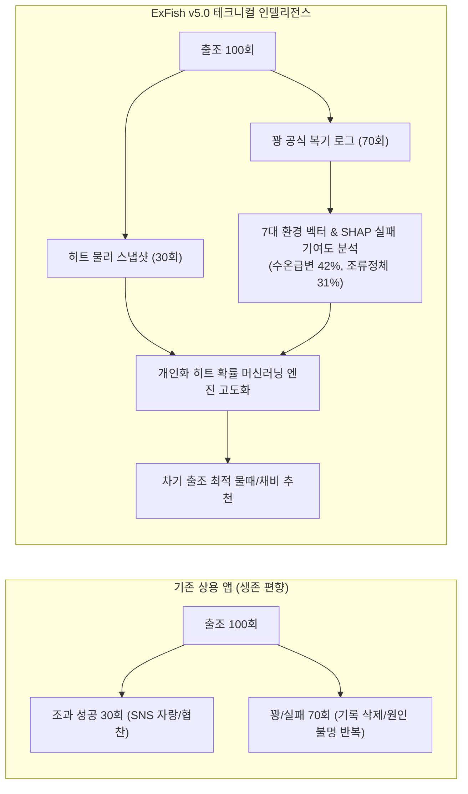
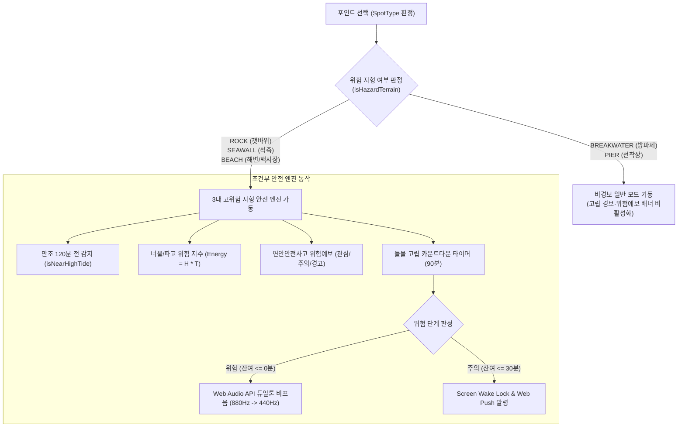
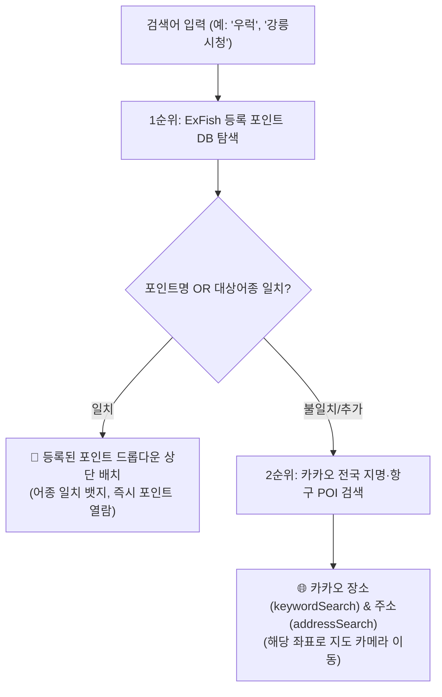
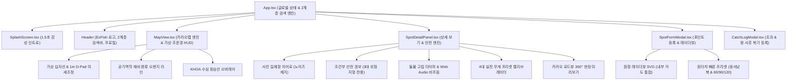

# 🎣 ExFish 모바일/웹 플랫폼 세부 설계 사양서 (v5.0 프로덕션 확정판)
> **슬로건**: *"ex-gf, ex-wife, and ex-fish. 떠나버린 물고기를 기리며..."*  
> **버전**: Version 5.0 (Field Ergonomics & Selective Safety Edition)  
> **최종 개정일**: 2026년 10월 23일  
> **공개 저장소**: [https://github.com/tlogger/espFish](https://github.com/tlogger/espFish)  
> **라이브 서비스**: [https://tlogger.github.io/espFish/](https://tlogger.github.io/espFish/)  
> **문서 상태**: 모바일 Android 하이브리드 앱 및 웹 프로덕션 배포용 엔지니어링 표준 사양 (Audited & Approved by @reviewer)

---

## 0. 공학 & 물리 기호 정의표 (Nomenclature Table)

본 사양서 전반에서 사용하는 물리량, 수학 기호, SI 단위 및 낚시 현장 관용 단위를 아래와 같이 정의합니다.

| 기호 (Symbol) | 물리량 명칭 (Quantity) | SI 단위 | 현장 관용 단위 | 기본값 / 기준 파라미터 |
| :--- | :--- | :---: | :---: | :--- |
| $D_{\text{cast}}$ | 지상 캐스팅 실효 비거리 | $\text{m}$ | $\text{m}$ | $55.0\text{ m}$ (기준 비거리) |
| $L_{\text{feet}}$ | 낚싯대(로드) 전장 규격 | $\text{m}$ | $\text{ft}$ (피트) | $8.6\text{ ft}$ (표준 에깅/워킹 루어대) |
| $W$ | 루어·채비 총 자중 (무게) | $\text{kg}$ | $\text{g}$ (그램), $\text{oz}$, 호 | 장르별 상이 ($0.5\text{g} \le W \le 150\text{g}$) |
| $W_{\text{opt}}$ | 로드 파워별 최적 스위트스팟 무게 | $\text{kg}$ | $\text{g}$ (그램) | M파워 기준 $22.0\text{g}$, 원투 $95\text{g}$ |
| $\eta_{\text{power}}$ | 로드 블랭크 탄성 에너지 축적 효율 | 무차원 ($0 \sim 1$) | $\%$ | 최적 부하 시 $1.00$ ($100\%$) |
| $\sigma_{\text{under}}$ | 저부하(Underload) 탄성 감쇄 표준편차 | 무차원 | 무차원 | $0.60$ |
| $\sigma_{\text{over}}$ | 과부하(Overload) 붕괴 표준편차 | 무차원 | 무차원 | $0.38$ |
| $\text{PE}$ | 원줄 합사(Braid Line) 호수 규격 | 무차원 (Gou) | 호 (PE) | $1.0\text{호}$ (직경 $\approx 0.165\text{mm}$) |
| $K_{\text{line}}$ | 원줄 공기역학 항력 감쇄 계수 | 무차원 | 무차원 | PE 1.0호 기준 $1.00$ |
| $K_{\text{wind}}$ | 풍향·풍속 벡터 비거리 보정 계수 | 무차원 | $\%$ | $0.65 \sim 1.35$ ($-35\% \sim +35\%$) |
| $S_{\text{drift}}$ | 측풍 및 합사 방출에 의한 횡방향 편류 거리 | $\text{m}$ | $\text{m}$ | 오렌지 라인 착수 편류 변위 |
| $v_{\text{sink}}$ | 루어 수중 정지 종단 침강 속도 | $\text{m/s}$ | $\text{m/s}$, $\text{sec/m}$ | 납 메탈 기준 $0.28\sqrt{W}$ |
| $C_{\text{lure}}$ | 루어 유체역학 형상 계수 | 무차원 | 무차원 | 메탈(1.00), 에기(0.25), 텅스텐(1.25) |
| $v_{\text{eff}}$ | 조류 원줄 양력 감쇄 유효 침강 속도 | $\text{m/s}$ | $\text{m/s}$ | $0.15 \sim 2.80\text{ m/s}$ (클램핑) |
| $V_{\text{current}}$ | 해류/조류 표층 유속 | $\text{m/s}$ | $\text{m/s}$, $\text{knot}$ | $1\text{ knot} \approx 0.514\text{ m/s}$ |
| $H$ | 캐스팅 착수 지점 수심 | $\text{m}$ | $\text{m}$ | KHOA 수심 등심선 기반 보간치 |
| $T_{\text{bottom}}$ | 채비 바닥 안착 소요 시간 (폴링 카운트) | $\text{s}$ (초) | $\text{초}$ | $H / v_{\text{eff}}$ |
| $D_{\text{drift,tide}}$ | 침강 중 조류에 의한 수평 흘림 거리 | $\text{m}$ | $\text{m}$ | $V_{\text{current}} \times T_{\text{bottom}}$ |
| $\hat{H}(t, \mathbf{x})$ | 시공간 하이브리드 보정 조위 수위 | $\text{cm}$ | $\text{cm}$ | 국립해양조사원(KHOA) 조위면 기준 |
| $H_{\text{harmonic}}$ | 4대 조화분조 합성 천문조위 | $\text{cm}$ | $\text{cm}$ | $M_2, S_2, K_1, O_1$ 분조 합성 |
| $\Delta H_{\text{obs}}$ | KHOA 관측소 실측 잔차 (Observed Error) | $\text{cm}$ | $\text{cm}$ | $H_{\text{obs}}(t_0) - H_{\text{harmonic}}(t_0)$ |
| $\lambda$ | 조위 잔차 시간 지수감쇄 계수 | $\text{h}^{-1}$ | $\text{h}^{-1}$ | $\lambda = \frac{\ln 2}{6} \approx 0.1155\text{ h}^{-1}$ (반감기 6h) |
| $R$ | 관측소-포인트 간 대권 거리 | $\text{km}$ | $\text{km}$ | Haversine 공식 산출치 |
| $R_0$ | 조위 잔차 공간 가우스 상관 거리 | $\text{km}$ | $\text{km}$ | $35.0\text{ km}$ ($2R_0 = 70\text{ km}$ 임계) |
| $T_{\text{escape}}$ | 들물 탈출 골든타임 | $\text{min}$ (분) | 분 (min) | 기본 $90\text{분}$ (조차 연동 동적 가변) |
| $\Delta H_{\text{tide}}$ | 일일 최대 조차 (만조위 - 간조위) | $\text{m}$ | $\text{m}$, $\text{cm}$ | 서해 대조기 기준 최대 $8.5\text{m}$ |
| $\mathbf{x}$ | 7대 환경 특성 입력 벡터 | 혼합 | 혼합 | 수온, 조류, 풍향, 기압, 파고 등 7개 차원 |
| $\phi_j$ | $j$번째 환경 인자의 SHAP 한계 기여도 | 무차원 | $\%$ | 로지스틱 회귀 logit 기여분 |

---

## 1. 프로젝트 개요 및 브랜드 철학

### 1.1 플랫폼 비전: '꽝'의 과학적 복기와 현장 인간공학 (Field Ergonomics)
기존 상용 낚시 애플리케이션(어신, 물반고기반, Fishbrain 등)은 1% 미만의 대형어 조과 사진과 협찬 광고에 치우친 **생존 편향(Survivorship Bias)**의 한계를 지닙니다. 그러나 실제 대한민국 연안 앵글러의 출조 중 60~70%는 입질 한 번 받지 못하는 **'꽝(Skunk/No-Fish/입질 무)'**입니다.

ExFish는 *"ex-gf, ex-wife, and ex-fish. 떠나버린 물고기를 기리며..."*라는 슬로건 아래, 실패한 출조를 단순 삭제하거나 망각하는 대신 **당시의 정량적 물리량(수온, 조석 수위, 유속 및 유향, 풍향·풍속, 기압, 루어/채비 무게, 원줄 호수)**으로 박제하여 실패 원인을 과학적으로 복기하는 **'프로 앵글러 전용 테크니컬 피싱 인텔리전스 계측기'**입니다.



### 1.2 핵심 기술 스택
- **프론트엔드 코어**: React 19 + TypeScript + Tailwind CSS v4 + Vite v8
- **모바일 네이티브 런타임**: Capacitor 7 Android 하이브리드 앱 아키텍처
- **지도 엔진**: 카카오 맵 JS SDK (`react-kakao-maps-sdk`) — 50cm급 고해상도 위성 실사 항공사진, 커스텀 벡터 오버레이
- **사운드 합성 엔진**: Web Audio API 기반 무의존 순수 듀얼톤($880\text{Hz} \rightarrow 440\text{Hz}$) 경보 합성기
- **백그라운드 안전장치**: Screen Wake Lock API (`navigator.wakeLock`) + Web Notifications API
- **차트 및 데이터 시각화**: Recharts 기반 반응형 SVG 면적/곡선 차트
- **해양 데이터 파이프라인**:
  - 국립해양조사원(KHOA) 바다누리 53개 조위관측소 실시간 API 및 4대 조화분조
  - Open-Meteo Marine & Weather API (표층수온, 유의파고, 파주기, 풍향/풍속, 기압)
  - KHOA 국가해양격자 4대 권역 벡터 수심 등심선(5m/10m/20m/50m) GeoJSON
- **스토리지 및 인증**: Supabase (PostgreSQL 15 + PostGIS + RLS) + IndexedDB (초경량 JSON 오프라인 캐시) + Email & 닉네임 기반 무암호 간편 인증 (`localStorage` 30일 세션 관리)

---

## 2. 지형 분류 체계 및 조건부 안전 경보 엔진

ExFish v5.0은 현장 낚시인의 실제 행동 패턴과 지형 위험도를 반영하여 **조건부 안전 경보(Selective Hazard Alerting)** 원칙을 확립합니다. 안전한 방파제나 선착장에서 불필요한 고립 경보가 남발되면 앵글러의 경각심이 둔화되는 **경보 피로(Alert Fatigue)**를 원천 방지합니다.



### 2.1 5대 지형 분류 및 위험 판정 로직
시스템은 `spot.spot_type`을 기준으로 위험 지형 여부를 다음과 같이 판정합니다:

```typescript
// 지형 위험 판정: 갯바위, 석축, 해변/백사장만 고립 위험 지형으로 분류
const isHazardTerrain = 
  spot.spot_type === 'ROCK' || 
  spot.spot_type === 'SEAWALL' || 
  spot.spot_type === 'BEACH';
```

| 지형 코드 (`SpotType`) | 한국어 지형 명칭 | 위험 지형 판정 (`isHazardTerrain`) | 고립 경보 & 위험예보 위젯 | 주요 필드 위험 요인 |
| :--- | :--- | :---: | :---: | :--- |
| **`ROCK`** | **갯바위** | **TRUE (위험)** | **상시 가동** | 들물 시 퇴로 침수, 너울성 파도 피격, 낙상 |
| **`SEAWALL`** | **석축** | **TRUE (위험)** | **상시 가동** | 만조 수위 상승 시 발판 침수, 해조류 미끄러짐 |
| **`BEACH`** | **해변 / 백사장** | **TRUE (위험)** | **상시 가동** | 갯골(Trench) 급류 차단, 이안류, 간출 사주 고립 |
| **`BREAKWATER`** | **방파제** | **FALSE (일반)** | **비활성화 (사족 제거)** | 테트라포드 추락 주의(별도 메모 안내) 외 고립 무관 |
| **`PIER`** | **선착장 / 물양장** | **FALSE (일반)** | **비활성화 (사족 제거)** | 육상 인접 평탄 지형으로 들물 고립 위험 전무 |

### 2.2 국립해양조사원·해양경찰청 연안안전사고 위험예보제 위젯
`isHazardTerrain === true`인 지형에서만 렌더링되며, 조석 주기(물때)와 파고·풍속을 결합하여 위험 단계를 자동 발령합니다:
1. **관심 (Blue/Amber)**: 소조기/중조기 평온 상태, 만조 접근 중.
2. **주의보 (Amber/Orange)**: 대조기(사리, 6~10물) 만조 전후 2시간대 진입 시 (`isNearHighTide === true`) 발령.
3. **경보 (Rose/Red)**: 대조기 만조 + 유의파고 $1.5\text{m}$ 이상 또는 풍속 $8.0\text{m/s}$ 이상 중첩 시 자동 발령.

### 2.3 들물 고립 카운트다운 타이머 & 3단계 상태 전이
가장 인접한 간조(들물 시작점)를 기준으로 경과 시간과 잔여 안전 시간을 실시간 계산합니다:
- **기준 안전 윈도우**: 간조 후 90분 ($T_{\text{escape}} = 90\text{분}$)
- **상태 전이**:
  - **`SAFE` (안전, 잔여 $> 30\text{분}$)**: `⏱️ 갯바위 들물 탈출 골든타임 카운트다운` 표출.
  - **`CAUTION` (주의, $0 < \text{잔여} \le 30\text{분}$)**: `⚠️ [들물 탈출 골든타임 임박] 안전 철수 준비` (주황색 테두리 및 경고 뱃지).
  - **`DANGER` (위험, 잔여 $\le 0\text{분}$)**: `🚨 [갯바위 침수 고립 위험] 즉시 철수하십시오!` (장미색 펄스 애니메이션 + 비프 경보 가동).

### 2.4 Web Audio API 무의존 듀얼톤 비프 사운드 엔진
외부 MP3/WAV 음원 파일 네트워크 로딩 실패나 브라우저 자동 재생 정책 차단을 방지하기 위해 순수 자바스크립트 오디오 컨텍스트(`AudioContext`)로 실시간 주파수를 합성합니다:
- **주파수 변조**: $880\text{Hz} \rightarrow 440\text{Hz}$ (하강 듀얼톤 사이렌 효과)
- **주기 알람**: 위험 상태 지속 시 25초 간격 자동 비프 발생
- **현장 테스트 스위치**: 앵글러가 출조 전 음량과 이어폰 연결을 확인할 수 있는 `[소리 테스트]` 토글 버튼 기본 탑재.

---

## 3. 캐스팅 공략 각도 (원형 레이더뷰) UI/UX 명세

과거 v3.x의 난해한 방위각(Azimuth) 문자열 방식과 비직관적인 UI 명칭을 현장 앵글러의 언어로 전면 개편하였습니다.

```
[원형 레이더뷰 통합 인터페이스 레이아웃]
┌────────────────────────────────────────────────────────┐
│ 🎯 캐스팅 방향                                [✓ 사용]  │
├────────────────────────────────────────────────────────┤
│                     [ N (360°) ]                       │
│                         │                              │
│       W (270°) ─────────┼───────── E (90°)             │
│                      45°│                              │
│                         │~ 135°                        │
│                     [ S (180°) ]                       │
│                                                        │
│   [시작 45°] ──────────●───────────── [종료 135°]      │
├────────────────────────────────────────────────────────┤
│ ⚡ 빠른 프리셋                                          │
│ [동(E)] [서(W)] [남(S)] [북(N)]  |  [60°] [90°] [120°]  │
└────────────────────────────────────────────────────────┘
```

### 3.1 레이블 및 토글 버튼 표준화
- **헤더 타이틀**: `🎯 캐스팅 방향`으로 통일 (초보자도 단번에 의도를 파악).
- **사용 여부 스위치**:
  - 활성화 시: **`✓ 사용`** (에메랄드/시안 하이라이트 배경).
  - 비활성화 시: **`미사용`** (슬레이트 배경).

### 3.2 SVG 원형 레이더 통합 뷰 (Internal Angle Labeling)
1. **내부 각도 통합 렌더링**:
   - 레이더 뷰 외부의 번잡한 텍스트를 제거하고, SVG 원형 캔버스 내부 중심부에 `45°` (에메랄드, 시작각) 및 `~ 135°` (시안, 종료각)를 대형 폰트로 직접 렌더링.
2. **원클릭 각도 지정 (Interactive Click Listener)**:
   - 레이더 원형 뷰의 임의 지점을 터치/클릭하면 중심점$(cx, cy)$ 기준 각도를 즉각 역산($\text{atan2}$)하여 가장 가까운 핸들(시작각 또는 끝각)로 자동 스냅.
3. **듀얼 슬라이더 ($0^\circ \sim 359^\circ$)**:
   - 시작각(에메랄드 액센트)과 종료각(시안 액센트)을 1도 단위로 정밀 조작 가능.

### 3.3 2계층 원터치 빠른 프리셋 (Cardinal & Aperture Presets)
현장에서 장갑을 끼거나 젖은 손으로 슬라이더를 섬세하게 움직이기 어려운 상황을 위해 원터치 버튼을 지원합니다:
1. **4대 방위 프리셋 (주 공략면 90° 부채꼴)**:
   - **동(E)**: 시작 $45^\circ$ ~ 종료 $135^\circ$
   - **서(W)**: 시작 $225^\circ$ ~ 종료 $315^\circ$
   - **남(S)**: 시작 $135^\circ$ ~ 종료 $225^\circ$
   - **북(N)**: 시작 $315^\circ$ ~ 종료 $45^\circ$
2. **화각(Aperture) 프리셋**:
   - 현재 바라보는 중심각을 기준으로 **`60°` (집중 투구)**, **`90°` (표준 탐색)**, **`120°` (광각 원투)**을 즉시 확장/축소.

---

## 4. 지도 엔진 및 HUD 시각화 명세

### 4.1 3대 지도 모드 전환
1. **🗺️ 일반 지도 (`ROADMAP`)**: 도심 및 항만 접근로, 주차장, 편의시설 탐색.
2. **🛰️ 고해상도 스카이뷰 (`HYBRID`)**: 50cm급 실사 항공사진으로 간출암, 수중여밭, 테트라포드 발판 배열 육안 식별.
3. **🌙 야간 다크 모드 (`DARK`)**: 캔버스 톤 반전 및 눈부심 방지 저조도 필터 적용 (`localStorage` 및 HTML data-attribute 영구 보존).

### 4.2 가상 십자선 조준경 & 1m D-Pad 정밀 조준
- **원격 타깃팅 개념**: 스마트폰 GPS의 $5 \sim 15\text{m}$ 수평 오차(CEP)를 극복하기 위해, 1m D-Pad는 발밑 GPS를 수정하는 것이 아니라 **"위성 영상에서 식별되는 전방 수중여나 간출암을 조준경처럼 미세 타깃팅"**합니다.
- **타깃팅 벡터 지향선 (Targeting Line)**:
  - 앵글러의 현재 GPS 수신 좌표와 가상 조준경 핀 사이에 황금색 점선 지향선 연결.
  - 지향선 중앙에 **`내 위치로부터 거리: XX.X m | 방위각: XXX°`** 플로팅 뱃지 표시.
- **모바일 경량화 D-Pad**: 40×40px 규격, 좌측 에메랄드 `[저장]`, 우측 슬레이트 `[취소]` 배치로 엄지 조작 최적화.

### 4.3 공기역학 채비 편류 오렌지 라인 (`orangeArcPts`)
- **수풍 면적 불균형 원리**: 60m 원투 시 합사 1.0호의 공중 노출 수풍 면적($\approx 107\text{ cm}^2$)은 2인치 웜 채비 자체 투영면적($\approx 5.5\text{ cm}^2$)의 **약 20배**에 달합니다. 캐스팅 시 줄이 옆으로 밀리는 현상의 90% 이상은 공중 합사 라인의 풍압력(Line Belly)에 기인합니다.
- **시각화 레이어**:
  1. 무풍 기준 목표 호선: 은은한 회색 점선.
  2. 실제 착수 호선: 오렌지색 실선 폴리라인 (stroke 3.5px, `#f97316`).
  3. 3대 착수 뱃지: 시점, 중간, 종점에 `{실제비거리}m ({우/좌} {밀림}m)` 실시간 표출.

### 4.4 KHOA 수심 등심선 연동 침강 속도 및 바닥 안착 HUD
- 착수 위치의 KHOA 국가해양격자 수심($-H\text{ m}$)을 자동 보간하여 HUD에 표출:
  - `🌊 착수수심: -12m | ⏱️ 바닥 안착: 약 14초 | 조류 흘림 +5.8m`

---

## 5. 공기역학 채비 및 로드 탄성 비거리 & 바람 편류(Drift) 물리 엔진

ExFish는 단순 추정이 아닌, 낚싯대의 블랭크 탄성 에너지 축적과 공기역학 항력 역학에 기반한 통합 비거리 공식과 횡방향 수풍 편류 모델을 적용합니다.

### 5.1 통합 캐스팅 비거리 공식
$$D_{\text{cast}} = 55\text{ m} \times K_{\text{length}} \times \eta_{\text{power}}(W) \times K_{\text{line}}(\text{PE}) \times K_{\text{wind}}$$

```
[비거리 결정 파이프라인]
  로드 전장 지렛대 계수: K_length = (Length / 8.6)^0.65
                    ×
  비대칭 탄성 효율:     η_power = exp( - (ln W - ln W_opt)^2 / (2 * σ^2) )
                    ×
  원줄 합사 공기항력:   K_line = (1.0 / PE)^0.22
                    ×
  풍향/풍속 벡터 보정:   K_wind (가벼운 채비 + 굵은 합사 맞바람 패널티 가중)
```

### 5.2 지그헤드 + 2인치 쉐드 웜 및 합사 방출 길이/두께 연동 바람 편류(Crosswind Drift) 산식
$$S_{\text{drift}} = \frac{1}{2} a_{\perp} (t_{\text{flight}})^2 \times \text{damp} + |V_{\perp}| \cdot t_{\text{flight}} \cdot 0.06\sqrt{\text{PE}}$$

1. **채비 및 합사 유효 투영 측면적**:
   - $A_{\text{rig}} = (L_{\text{worm}} \times H_{\text{worm}}) + A_{\text{jighead}} \approx (2.0 \times 0.0254 \times 0.008) + 0.00015 \approx 0.00055\text{ m}^2$ ($C_{d,\text{rig}} \approx 0.70$)
   - $A_{\text{line}} = L_{\text{line}} \times d_{\text{line}} = (D_{\text{eff}} \times 1.08) \times (0.000165\text{m} \times \sqrt{\text{PE}})$ ($C_{d,\text{line}} \approx 1.15$)
2. **횡방향 풍압력 및 가속도**:
   $$F_{\perp} = \frac{1}{2} \rho_{\text{air}} |V_{\perp}|^2 \left( 0.65 C_{d,\text{rig}} A_{\text{rig}} + 0.35 C_{d,\text{line}} A_{\text{line}} \right)$$
   $$a_{\perp} = \frac{F_{\perp}}{M_{\text{rig}}} \quad \left(M_{\text{rig}} = \frac{W}{1000}\text{ kg}\right)$$
3. **체공 시간 및 라인 텐션 감쇄**:
   - $t_{\text{flight}} \approx 0.38 \sqrt{D_{\text{eff}}}$ (초), $\text{damp} = 0.38$
4. **강풍 시 엣지 케이스 안전 가이드라인**:
   - 풍속 $12\text{m/s}$ 이상의 강풍/돌풍 감지 시 최대 편류량은 $D_{\text{eff}} \times 0.35$로 물리적 상한 클램핑.

### 5.3 로드 파워별 최적 스위트스팟 ($W_{\text{opt}}$) 규격표
| 로드 파워 (Power) | 최적 무게 ($W_{\text{opt}}$) | 권장 허용 무게 | 주요 대상 장르 |
| :--- | :---: | :---: | :--- |
| **UL (울트라라이트)** | **3 g** | 1 ~ 7 g | 볼락, 아징(전갱이) 지그헤드 |
| **L (라이트)** | **7 g** | 3 ~ 12 g | 호래기, 우럭 라이트 다운샷 |
| **ML (미디엄라이트)** | **18 g** | 7 ~ 30 g | 주꾸미, 에기, 라이트루어 |
| **M (미디엄 표준)** | **22 g** | 10 ~ 35 g | 무늬오징어 에깅 3.5호, 광어 다운샷 |
| **MH (미디엄헤비)** | **35 g** | 14 ~ 50 g | 농어 미노우, 중형 삼치 스푼 |
| **H (헤비)** | **48 g** | 25 ~ 60 g | 쇼어지깅(방어/부시리 메탈지그) |
| **SURF (원투대)** | **95 g** | 30 ~ 150 g | 원투 낚시 (봉돌 8~40호) |

### 5.4 비대칭 스플릿 로그-가우시안 로드 탄성 효율 곡선 ($\eta_{\text{power}}$)
$$\eta_{\text{power}}(W) = \begin{cases}
\exp\left( - \frac{(\ln W - \ln W_{\text{opt}})^2}{2 \sigma_{\text{under}}^2} \right), & W < W_{\text{opt}} \quad (\sigma_{\text{under}} = 0.60, \text{ 저부하 탄성 미달}) \\
\exp\left( - \frac{(\ln W - \ln W_{\text{opt}})^2}{2 \sigma_{\text{over}}^2} \right), & W \ge W_{\text{opt}} \quad (\sigma_{\text{over}} = 0.38, \text{ 과부하 탄성 붕괴})
\end{cases}$$

---

## 6. 수중 침강(폴링) 및 조류 흘림 물리 엔진

### 6.1 루어 유체역학 형상 계수 ($C_{\text{lure}}$) 도입 수중 종단 속도 ($v_{\text{sink}}$)
$$v_{\text{sink}} \approx C_{\text{lure}} \times 0.28 \times \sqrt{W\text{ (g)}} \quad (\text{m/s}) \quad [0.15\text{ m/s} \le v_{\text{sink}} \le 2.80\text{ m/s} \text{ 클램핑}]$$

| 루어 카테고리 (Lure Type) | 형상 계수 ($C_{\text{lure}}$) | 침강 특성 및 유체역학적 근거 | 대표 사용 장르 |
| :--- | :---: | :--- | :--- |
| **텅스텐 마이크로 지그** | **1.25** | 초고밀도(납 대비 1.7배), 최소 투영 단면적으로 물 저항 최소화 | 아징, 락피시 초원투 |
| **납 메탈지그 / 캐스팅 스푼** | **1.00** | 유선형 메탈 슬림 바디 (기준 표준 계수) | 쇼어지깅, 삼치·방어 |
| **바이브레이션 / 블레이드 루어** | **0.85** | 루어 전면 플랫 헤드 및 회전 블레이드의 수압 저항 | 농어, 광어 바이브 |
| **지그헤드 + 3~4인치 웜** | **0.65** | 웜 꼬리(패들/그럽) 수류 저항으로 인한 감속 폴링 | 우럭, 볼락 지그헤드 |
| **슬로우 피치 지그 / 플랫 메탈** | **0.50** | 비대칭 바디의 슬라이드 및 플러터링 폴링 액션 | 바닥층 락피시, 넙치 |
| **오징어 에기 3.5호 (Egi)** | **0.25** | 침강률 표준 $3.0 \sim 3.5\text{s/m}$, 깃털 날개/싱커 밸런스 저항 | 무늬오징어, 한치 |

### 6.2 조류에 의한 원줄 양력 감쇄 및 바닥 안착 시간
$$v_{\text{eff}} = \frac{v_{\text{sink}}}{\sqrt{1 + \left(\frac{V_{\text{current}}}{0.6 \cdot v_{\text{sink}}}\right)^2}}$$
$$T_{\text{bottom}} = \frac{H}{v_{\text{eff}}} \quad (\text{초}), \quad D_{\text{drift,tide}} = V_{\text{current}} \times T_{\text{bottom}} \quad (\text{m})$$

---

## 7. 현장 최적화 상세 보기 패널 & 캘리브레이터

### 7.1 상단 일체형 히어로 패널 (Noise Removal)
필드 앵글러가 가장 필요로 하는 정보에 즉시 도달할 수 있도록 불필요한 시각적 잡음(Noise)을 완전히 제거했습니다:
1. **제거된 노이즈**:
   - `KHOA 수심 등심선 표시중` 사족 배너 삭제.
   - `조위관측소 거리 및 잔차 가중치` 디버깅용 텍스트 제거.
   - `파도 높이/너울 텍스트` 중복 문구 제거.
2. **Superimpose 히어로 구조**:
   - 사진 위에 **[지형 뱃지]**, **[포인트명]**, **[대상 어종]**을 오버레이하고, 그 바로 아래에 **`[날씨] · [기온] · [수온]`**을 단일 캡슐 인라인으로 통합 배치하여 첫 화면 높이를 획기적으로 압축.

### 7.2 카카오맵 및 360° 로드뷰 딥링크
- **길찾기 연동**: 포인트에 등록된 네비 검색명(`navi_name`) 및 URL 연동.
- **카카오 로드뷰 360° 원클릭 미리보기**:
  - `https://map.kakao.com/link/roadview/${spot.lat},${spot.lng}` 딥링크 버튼 탑재.
  - 출조 전 진입로의 테트라포드 높이, 주차 공간, 갯바위 갯벌 여부를 로드뷰로 사전 확인 가능.

### 7.3 4대 실전 무게 카테고리 프리셋 캘리브레이터
전통적인 슬라이더 단일 조작 방식에서 탈피하여, 대한민국 루어/원투 낚시인이 실전에서 사용하는 4대 규격 탭과 프리셋을 제공합니다:

1. **지그헤드 (g)**: 1g, 2g, 3g, 5g
2. **온스 루어 (oz)**: 1/32, 1/16, 3/32, 1/8, 3/16, 1/4, 3/8, 1/2, 3/4, 1oz
3. **주꾸미 봉돌 (호, 1호=3.75g)**: 3호, 4호, 5호, 6호, 7호
4. **원투 봉돌 (호)**: 8호, 10호, 12호, 15호, 18호, 20호, 25호, 30호, 35호, 40호 ($30\text{g} \sim 150\text{g}$)

---

## 8. 2계층 지능형 검색 & 모바일 IME 최적화

### 8.1 2계층 검색 아키텍처 (Hierarchical Search)
검색어 입력 시 낚시 전용 데이터와 일반 지리 데이터를 엄격히 분리하여 2계층으로 표출합니다:



1. **1순위 (등록 포인트 & 대상 어종)**:
   - 포인트명뿐만 아니라 **대상 어종(`target_species`)** 배열을 실시간 스캔.
   - 예: '우럭' 검색 시 우럭이 서식하는 등록 포인트 목록이 상단에 추출되며, `[어종 일치]` 뱃지와 함께 클릭 시 해당 포인트의 상세 조석/입질 패널이 즉시 오픈.
2. **2순위 (카카오 전국 POI & 지명)**:
   - 등록되지 않은 신규 출조지(예: '강릉시청', '삼척항 방파제') 입력 시 카카오 키워드/주소 검색 API를 연동하여 지도 좌표 중심 이동.

### 8.2 모바일 한글 IME 자모 분리 방지 (IME Composition State)
모바일 브라우저 및 안드로이드 웹뷰에서 한글 입력 시 발생하는 자모 씹힘(예: 'ㅇㅜㄹㅓㄱ') 및 조합 미완료 중복 검색 문제를 방지하기 위해 `isComposing` 상태를 분리 제어합니다:
- `onCompositionStart` 및 `onCompositionEnd` 핸들러 바인딩.
- 엔터키(`Enter`) 입력 시 조합 중인 상태를 안전하게 확정한 후 검색 트리거.

---

## 9. 모바일 앱 환경 및 오프라인 정책

### 9.1 1.5초 감성 스플래시 스크린 & 벡터 SVG 아이콘
- **스플래시 스크린**:
  - 앱 구동 시 갯바위 실사 풍경과 함께 단 한 줄의 슬로건 **"떠난 물고기를 기리며..."**가 은은한 비네팅과 함께 노출.
  - 정확히 **1.15초에 부드러운 페이드아웃**, **1.5초 정각에 언마운트**되어 앵글러의 현장 조작 대기 시간을 제로화.
- **네이티브 벡터 SVG 런처 아이콘**:
  - 해상도 깨짐 없는 미니멀 네이티브 벡터 아이콘 적용 (`res/mipmap` 5개 밀도 HDPI~XXHDPI 지원).

### 9.2 카카오 규정 준수 초경량 JSON 오프라인 캐싱 (IndexedDB)
- **법적 규정 준수**: 카카오 맵 이용약관(ToS)을 위반하는 지도 타일 이미지의 불법 로컬 저장을 일체 배제.
- **초경량 JSON 캐싱**:
  - 등록된 포인트 메타데이터, 42시간 조석표, 최근 기상 관측 벡터, 꽝 복기 로그 스키마만을 IndexedDB에 암호화 저장.
  - 서해/남해안 갯바위 등 LTE/5G 음영 지역에 진입하더라도 기 다운로드된 포인트 제원과 조석 피딩 타임라인을 100% 정상 열람 가능.

### 9.3 Capacitor Android 하이브리드 아키텍처
- `capacitor.config.ts`:
  - `appId`: `com.tlogger.exfish`
  - `appName`: `ExFish`
  - `allowMixedContent: true` (해양 기상 공공 API 호환성 보장)
  - `webContentsDebuggingEnabled: true`

---

## 10. 시스템 컴포넌트 아키텍처 매핑 및 데이터 모델

### 10.1 TypeScript 핵심 인터페이스 (`src/types/index.ts`)

```typescript
export type SpotType = 'ROCK' | 'SEAWALL' | 'BREAKWATER' | 'BEACH' | 'PIER';
export type FishingMethod = 'SURF' | 'LURE' | 'FLOAT';

export interface FishingSpot {
  id: string;
  user_id: string;
  author_name: string;
  is_public: boolean;
  name: string;
  spot_type: SpotType;
  lat: number;
  lng: number;
  navi_name?: string;
  navi_url?: string;
  directions: string;
  photo_urls: string[];
  fishing_methods: FishingMethod[];
  target_species: string[];
  best_tides?: string[];
  best_times?: string[];
  best_seasons?: number[];
  description?: string;
  casting_start_deg?: number; // 0~359° (북쪽 0° 기준 시계방향)
  casting_end_deg?: number;   // 0~359°
  created_at: string;
}

export interface CatchLog {
  id: string;
  spot_id: string;
  user_id: string;
  user_name: string;
  catch_date: string; // YYYY-MM-DD
  catch_time: string; // HH:mm
  fish_species: string;
  fish_count: number; // 0 = 꽝 (No-Fish)
  is_hitless?: boolean;
  fish_size_cm?: number;
  catch_method: FishingMethod;
  lure_bait?: string;
  catch_mul: string;
  tide_state: string;
  water_temp: number;
  wind_speed: number;
  wind_direction?: number;
  current_velocity?: number;
  wave_height?: number;
  environment_snapshot?: Record<string, any>;
  post_mortem_data?: Record<string, any>; // SHAP 꽝 복기 기여도
  created_at: string;
}
```

### 10.2 프론트엔드 컴포넌트 계층도



---

## 11. 버전 변경 이력 (Changelog)

- **v1.0 ~ v3.8**: Leaflet 프로토타입에서 카카오맵 JS SDK 전면 전환, 20대 어종 생태 DB 구축, 조석 곡선 및 가상 조준경 HUD 구현.
- **v4.0 ~ v4.2**: 비대칭 스플릿 로그-가우시안 로드 탄성 효율 모델, 루어 유체역학 형상 계수($C_{\text{lure}}$), KHOA 실측 잔차 시공간 하이브리드 감쇄 모델, 지그헤드+2인치 웜 바람 편류 오렌지 아크 적용.
- **v5.0 (현재 개정판 - Field Ergonomics & Selective Safety Edition)**:
  - **지형 분류 체계 및 조건부 안전 경보 엔진 확립**: 방파제/선착장의 경보 피로를 해소하고, 석축/갯바위/해변 3대 위험 지형에만 고립 타이머 및 연안안전위험예보 선택적 가동.
  - **원형 레이더뷰 UX 혁신**: 직관적인 '🎯 캐스팅 방향' 명칭, 레이더 내부 각도 직접 표기, 원터치 빠른 프리셋(동/서/남/북 및 60°/90°/120°), '✓ 사용' 스위치 확정.
  - **상세 보기 패널 노이즈 제거**: 관측소 거리, 중복 파도 문구 등 개발용 사족을 전면 제거하고 사진 일체형 Superimpose 히어로로 시인성 극대화.
  - **4대 실전 무게 프리셋 캘리브레이터**: 지그헤드(g), 온스 루어(oz), 주꾸미 봉돌(호), 원투 봉돌(호) 실전 규격 탑재.
  - **2계층 지능형 검색 & 모바일 IME 최적화**: 1순위 등록 포인트 및 대상 어종 매칭, 2순위 카카오 POI 분리 및 한글 자모 씹힘 방지.
  - **모바일 앱 & 오프라인 정책**: 1.5초 감성 스플래시 스크린, 벡터 SVG 런처 아이콘, 카카오 ToS 준수 초경량 JSON IndexedDB 오프라인 캐시 확립.
