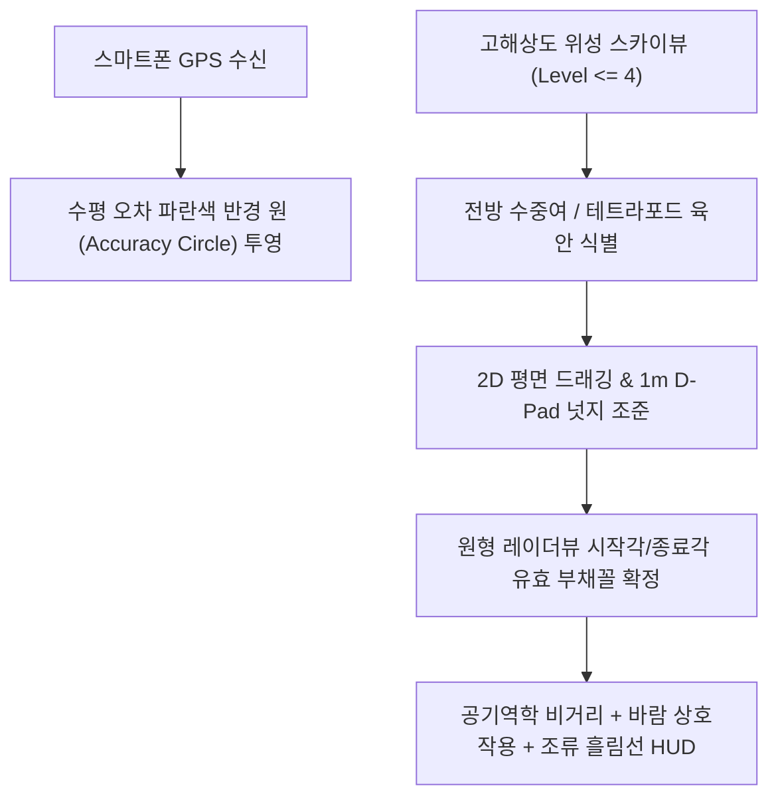
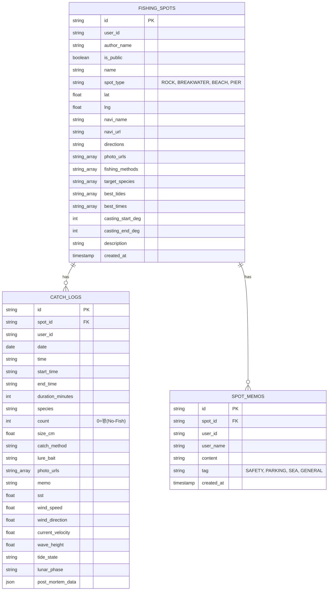

# 🎣 ExFish 웹 플랫폼 세부 설계 사양서 (v4.0 최종 확정)
> **슬로건**: *"ex-gf, ex-wife, and ex-fish. 떠나버린 물고기를 기리며..."*  
> **버전**: Version 4.0 (Comprehensive Architecture & Engineering Specification)  
> **최종 개정일**: 2026년 10월 21일  
> **공개 저장소**: [https://github.com/tlogger/espFish](https://github.com/tlogger/espFish)  
> **라이브 서비스**: [https://tlogger.github.io/espFish/](https://tlogger.github.io/espFish/)

---

## 1. 프로젝트 개요 및 브랜드 철학

### 1.1 플랫폼 비전: 실패의 과학적 데이터 복기
기존 상용 낚시 앱(어신, 물반고기반, Fishbrain 등)은 1% 미만의 대형어 조과 사진과 협찬 광고에 치우친 **생존 편향(Survivorship Bias)**의 한계를 지닙니다. 그러나 실제 앵글러의 출조 중 60~70%는 입질 한 번 받지 못하는 **'꽝(Skunk/No-Fish)'**입니다.

ExFish는 *"ex-gf, ex-wife, and ex-fish. 떠나버린 물고기를 기리며..."*라는 슬로건 아래, 실패한 출조를 단순 삭제하거나 망각하는 대신 **당시의 정량적 물리량(수온, 조석, 유속, 풍향·풍속, 채비, 기압)**으로 박제하여 실패 원인을 과학적으로 복기하는 **'프로 앵글러 전용 테크니컬 피싱 인텔리전스 계측기'**입니다.


### 1.2 핵심 기술 스택
- **프론트엔드 코어**: React 19 + TypeScript + Tailwind CSS v4 + Vite v8
- **지도 엔진**: 카카오 맵 JS SDK (`react-kakao-maps-sdk`) — 50cm급 고해상도 위성 실사 항공사진, 커스텀 벡터 오버레이
- **사운드 합성 엔진**: Web Audio API 기반 무의존 순수 듀얼톤($880\text{Hz} \rightarrow 440\text{Hz}$) 경보 합성기
- **차트 및 데이터 시각화**: Recharts 기반 반응형 SVG 면적/곡선 차트
- **데이터 파이프라인**:
  - 국립해양조사원(KHOA) 바다누리 53개 조위관측소 실시간 API 및 4대 조화분조
  - Open-Meteo Marine & Weather API (표층수온, 유의파고, 파주기, 풍향/풍속, 기압)
  - KHOA 국가해양격자 4대 권역 벡터 수심 등심선(5m/10m/20m/50m) GeoJSON
- **스토리지 및 인증**: Supabase (PostgreSQL + RLS) + IndexedDB (초경량 JSON 오프라인 캐시) + OAuth 2.0 (구글, 애플, 네이버, 카카오)

---

## 2. 지도 엔진 및 가상 조준경 물리 HUD 명세



### 2.1 3대 지도 모드 전환
1. **🗺️ 일반 지도 (`ROADMAP`)**: 주간에 항만 지명, 주차장, 도로를 직관적으로 파악.
2. **🛰️ 고해상도 스카이뷰 (`HYBRID`)**: 50cm급 실사 항공사진으로 갯바위 여밭, 물골, 간출암, 테트라포드 발판을 실사로 정밀 탐색.
3. **🌙 야간 다크 모드 (`DARK`)**: 캔버스 톤 반전 및 저조도 야간 시야 보호 테마 적용 (`localStorage` 영구 보존).

### 2.2 가상 십자선 조준경 (Virtual Crosshair) & 2D 평면 미세 조정
- **개념 재정의**: 스마트폰 GPS의 5~15m 수평 오차(CEP)를 고려하여, 1m D-Pad는 발밑 GPS 수정이 아닌 **"위성 실사 영상에서 육안 식별되는 전방 수중여/간출암/방파제 끝선을 원격 조준하는 조준경"**으로 동작.
- **GPS 정확도 원 시각화**: 기기 수신 정확도(`coords.accuracy`)를 반투명 청색 원(`accuracyCircle`)으로 지도상에 실시간 투영.
- **마커 2D 드래깅 및 1m 넛지**:
  - 본인이 등록한 포인트일 때만 **`[🎯 위치 미세조정]`** 아이콘 활성화.
  - 클릭 시 최고 배율(Level 1) 위성 스카이뷰로 자동 전환되며, 지도 위 핀을 직접 드래그하거나 동서남북 1m D-Pad로 픽셀 단위 넛지 이동 후 저장.

### 2.3 원형 레이더뷰 유효 캐스팅 부채꼴 섹터
- **시작각 및 종료각 지정**: 방위 문자열(N, NE 등) 대신 각도기 다이얼 또는 슬라이더를 통해 유효 공략 각도(예: $45^\circ \sim 135^\circ$)를 지정.
- **레이더 가이드 라인**: 시작각(녹색 점선)과 종료각(시안색 점선)이 최대 사거리까지 뻗어나가며, 호 중심에는 거리 눈금 뱃지 표출.
- **전방위(ALL) 폐지**: 실제 갯바위/방파제는 배후 육지가 존재하므로 물리적 타당성을 위해 전방위 지정을 제거하고 유효 부채꼴 각도로 표준화.

### 2.4 실시간 바람·조류 상호작용 물리 HUD
- **바람 벡터 ($W_{\text{to}} = (W_{\text{from}} + 180^\circ) \bmod 360^\circ$)와 캐스팅 각도($\theta_{\text{cast}}$)의 각도차($\Delta\theta$) 판정**:
  - **등바람 (Tailwind, $\Delta\theta \le 45^\circ$)**: 에메랄드 그린 화살표, **비거리 최대 $+35\%$ 증가** 시각화.
  - **맞바람 (Headwind, $\Delta\theta \ge 135^\circ$)**: 로즈 레드 화살표, **비거리 최대 $-35\%$ 감소** 시각화.
  - **옆바람 (Crosswind)**: 앰버 골드 화살표, **'옆바람 줄날림 주의'** 경고 및 탄착 유효호 수축.
- **실시간 조류 흘림선 (Drift Path)**: 착수 지점으로부터 실시간 유속($V_{\text{current}}$)과 유향에 따른 채비 흘림 궤적을 점선 화살표로 투영.

---

## 3. 공기역학 채비 및 로드 탄성 비거리 계산 엔진

ExFish는 단순 추정이 아닌, 낚싯대의 블랭크 탄성 에너지 축적과 공기역학 항력 역학에 기반한 통합 비거리 공식을 적용합니다.

### 3.1 통합 캐스팅 비거리 공식
$$D_{\text{cast}} = 55\text{ m} \times K_{\text{length}} \times \eta_{\text{power}}(W) \times K_{\text{line}}(\text{PE}) \times K_{\text{wind}}$$

```
[비거리 결정 파이프라인]
  로드 전장 지렛대 계수: K_length = (Length / 8.6)^0.65
                    ×
  로드 파워 탄성 효율: η_power = exp( - (ln W - ln W_opt)^2 / (2 * 0.55^2) )
                    ×
  원줄 합사 공기항력: K_line = (1.0 / PE)^0.22
                    ×
  풍향/풍속 벡터 보정: K_wind (등바람 +35% ~ 맞바람 -35%)
```

### 3.2 로드 파워별 최적 스위트스팟 ($W_{\text{opt}}$) 규격표
| 로드 파워 (Power) | 최적 무게 ($W_{\text{opt}}$) | 권장 허용 무게 | 주요 대상 장르 |
| :--- | :---: | :---: | :--- |
| **UL (울트라라이트)** | **3 g** | 1 ~ 7 g | 볼락, 아징(전갱이) 지그헤드 |
| **L (라이트)** | **7 g** | 3 ~ 12 g | 호래기, 우럭 라이트 다운샷 |
| **ML (미디엄라이트)** | **14 g** | 7 ~ 21 g | 주꾸미, 갑오징어 소형 에기 |
| **M (미디엄 표준)** | **22 g** | 10 ~ 35 g | 무늬오징어 에깅 3.5호, 광어 다운샷 |
| **MH (미디엄헤비)** | **35 g** | 18 ~ 50 g | 농어 미노우, 중형 삼치 스푼 |
| **H (헤비)** | **60 g** | 30 ~ 90 g | 쇼어지깅(방어/부시리 메탈지그) |
| **XH (엑스트라헤비)** | **100 g** | 50 ~ 150 g+ | 서프 원투 낚시, 헤비 플러깅 |

### 3.3 로드 길이 계수 ($K_{\text{length}}$)
$$K_{\text{length}} = \left(\frac{L_{\text{feet}}}{8.6}\right)^{0.65}$$
- $6.6\text{ft}$: $\times 0.84$ (선상/내항)
- $8.6\text{ft}$: $\times 1.00$ (에깅/워킹 표준)
- $10.6\text{ft}$: $\times 1.15$ (서프 장타)
- $14.8\text{ft}$ (4.5m 서프): $\times 1.42$ (원투대)

---

## 4. 수중 침강(폴링) 및 조류 흘림 물리 엔진

루어가 수면에 착수한 직후 바닥(해저면)까지 도달하는 시간과 조류 밀림을 유체역학 종단 속도와 원줄 양력 감쇄 모델로 계산합니다.

```
착수 지점 (수면)
    │  \
    │   \  조류에 밀리는 실제 궤적
 수심(H)  \  유효 침강 속도 (Veff)
    │      \
    ↓        ↘
해저 바닥 ─────→ [착저 지점: 조류 방향으로 Ddrift 만큼 밀림]
```

### 4.1 수중 정지 침강 속도 ($v_{\text{sink}}$)
고밀도 납/텅스텐 메탈 기준 종단 속도:
$$v_{\text{sink}} \approx 0.28 \times \sqrt{W\text{ (g)}} \quad (\text{m/s}) \quad [0.35\text{ m/s} \sim 2.50\text{ m/s} \text{ 클램핑}]$$

### 4.2 조류에 의한 원줄 양력 감쇄 및 유효 침강 속도 ($v_{\text{eff}}$)
조류가 흐르면 원줄(합사)에 수압 저항이 생겨 루어의 침강을 방해합니다:
$$v_{\text{eff}} = \frac{v_{\text{sink}}}{\sqrt{1 + \left(\frac{V_{\text{current}}}{0.6 \cdot v_{\text{sink}}}\right)^2}}$$

### 4.3 바닥 안착 시간 ($T_{\text{bottom}}$) 및 조류 흘림 거리 ($D_{\text{drift}}$)
- **바닥 안착 소요 시간**:
  $$T_{\text{bottom}} = \frac{H}{v_{\text{eff}}} \quad (\text{초})$$
- **침강 중 조류 흘림 거리**:
  $$D_{\text{drift}} = V_{\text{current}} \times T_{\text{bottom}} \quad (\text{m})$$

### 4.4 HUD 표기 형태
- **지도 착수 뱃지**: `🎯 공략각 | 사거리 55m` / `🌊 착수수심 -12m | ⏱️ 바닥 안착: 약 9초 (조류 흘림 +4.5m)` / `로드 8.6ft M (탄성효율 98%) · 25g/PE 1.0호`
- **상세 패널 가이드 표**: 현재 조류 유속을 반영하여 수심 $3\text{m}, 5\text{m}, 8\text{m}, 12\text{m}, 18\text{m}$에서 몇 초를 세고 릴링/액션을 시작해야 하는지 카운트다운 표 제공.

---

## 5. KHOA 수심 등심선 & 하이브리드 조위 엔진

### 5.1 KHOA 국가해양격자 벡터 수심 등심선 오버레이
- **4대 권역 벡터 데이터셋**: 서해안, 남해안, 동해안, 제주도 연안의 **5m(하늘색 여밭), 10m(파란색 브레이크라인), 20m(인디고 본류대 갯골), 50m(보라색 외해선)** 벡터 폴리라인 구축.
- **지도 컨트롤**: 우상단 **`[🌊 수심선]`** 토글 버튼 탑재.
- **착수 지점 예상 수심 자동 계산 (`estimateDepthAtPoint`)**: 발판 종류(갯바위 급심, 방파제, 백사장 완경사)와 비거리에 따른 수심 경사도 모델로 캐스팅 착수점의 예상 수심을 $-X.X\text{m}$로 자동 계산.

### 5.2 KHOA 53개 관측소 실시간 API 연동 & 잔차 지수감쇄 하이브리드 엔진
단순 천문조위의 기압/풍향 오차를 보정하기 위해 국립해양조사원 실측치와 합성합니다.

$$\hat{H}(t) = H_{\text{harmonic}}(t) + \Delta H_{\text{obs}}(t_0) \cdot e^{-\lambda (t - t_0)} + \Delta H_{\text{meteo}}(t)$$

- **$\Delta H_{\text{obs}}(t_0)$**: 기준 시각 $t_0$에서 Haversine 공식으로 탐색한 가장 가까운 KHOA 조위관측소의 실측 잔차.
- **$e^{-\lambda (t - t_0)}$**: 잔차의 시간 감쇄 함수 (반감기 6시간, $\lambda \approx 0.1155\text{ h}^{-1}$).
- **$\Delta H_{\text{meteo}}(t)$**: 역기압 효과 보정 ($(1013.25 - P_t) \times 1.01\text{ cm}$).
- **상세 패널 표시**: 36시간 조위 그래프 상단에 `📍 KHOA [관측소명] (직선거리 X.Xkm) | 하이브리드 잔차(e^-λt) 보정 가동중` 실시간 뱃지 표출.

---

## 6. 해양 안전 및 조석 타임라인 명세

### 6.1 갯바위 들물 고립 방지 탈출 골든타임 카운트다운 타이머
- **들물 구간 산출**: 오늘 간조(Low Tide) 이후 바닷물이 유입되는 시점 실시간 추적.
- **90분 탈출 골든타임 역산**: 갯바위는 간조 후 1시간 30분이 지나면 낮은 진입로와 징검다리가 먼저 침수되므로, 간조 $+90$분을 최종 철수 데드라인으로 설정.
- **3단 시각 경보**:
  - **안전 구간 (잔여 > 30분)**: 들물 진행 시간 및 잔여 골든타임 안내.
  - **주의 구간 (잔여 1~30분)**: 앰버 경고창으로 전환되며 철수 준비 촉구.
  - **고립 위험 (잔여 $\le$ 0분)**: 플래싱 레드 경고창 및 즉시 퇴로 확보·구조 요청 안내.
- **Web Audio API 합성 비프 경보**: 외부 음원 파일 없이 $880\text{Hz} \rightarrow 440\text{Hz}$ 듀얼톤 비프 경보음 발생(`playEvacuationBeep()`), 원클릭 소리 테스트 및 25초 주기 비프 알람 스위치 지원.

### 6.2 너울(Swell) 위험도 3단계 지수 & 해경 위험예보 자동 감지
- **너울 파괴 에너지 지수**: $\text{Energy} = H_{\text{wave}} \times T_{\text{period}}$
  - $\text{Energy} \ge 12.0$ or $H \ge 2.0\text{m}$: `[🚨 DANGER 진입금지]`
  - $\text{Energy} \ge 7.0$ or $H \ge 1.3\text{m}$: `[⚡ CAUTION 주의요망]`
  - 그 외: `[✅ SAFE 양호]`
- **연안사고 위험예보 자동 감지**: 대조기(사리) 만조 전후 2시간대이거나 너울 파고 위험 시 플래싱 경보 배너 자동 활성화.

### 6.3 -6h ~ +36h (총 42시간) 연속 조위 곡선 & 피딩 타임
- 현재 시각 기준 과거 6시간부터 미래 36시간까지의 연속 조위 곡선을 가로 스크롤 없이 한 화면에 100% 반응형으로 렌더링.
- 조위 그래프 내에 **중들물 피딩 타임**, **일출 해창**, **일몰 피딩** 구간을 하이라이트 면적으로 직접 오버레이.
- 그래프 하단에 일출/일몰, 오늘 만조/간조 시각 및 조위(cm), 조차(cm) 요약 바 배치.

---

## 7. 어종 생태 입질 지수 & AI 꽝 사후 복기 리포트

### 7.1 어종별 생태학적 입질 지수 연산 (`biteScore.ts`, `speciesDatabase.ts`)
- **한국 연안 20대 인기 어종 생태 DB**:
  - 우럭(조피볼락): 야행성 락피시, 야간 최고배점, 주간 감점, 적정 수온 10~17°C.
  - 주꾸미/갑오징어: 주행성 모래/뻘 서식, 사리 유속 감점, 조금~완류 고배점.
  - 무늬오징어/풀치: 여명/박명/야간 피딩, 집어등 반응, 조류 소통 우수 구간.
  - 감성돔/참돔: 여명/해질녘 피딩, 7~10물 사리 전후 조류 소통 구간 고배점.
- **개인화 맞춤형 배점**: 로그인 유저의 관심 어종(`favoriteSpecies`)을 1순위로 가중 반영하여 종합 입질 지수 및 1순위 추천 어종 실시간 도출.

### 7.2 7대 환경 벡터 기반 꽝 원인 SHAP 분해 AI 복기 엔진 (`postMortemEngine.ts`)
조과 기록에서 마릿수 0으로 '꽝'이 등록되었을 때, 7대 환경 특성 벡터를 기반으로 로지스틱 회귀 및 한계 기여도(Shapley Value)를 연산하여 퍼센트(%) 기여도를 자동 도출합니다.

$$\mathbf{x} = \begin{bmatrix}
\Delta T_{\text{sst}} & (\text{적정 활성 수온과의 괴리}) \\
\nabla T_{3\text{h}} & (\text{최근 3시간 수온 급변화율}) \\
V_{\text{cur}} & (\text{조류 정체 페널티}) \\
W_{\text{head}} & (\text{맞바람 세기}) \\
P_{\text{tide}} & (\text{정체 물때 페널티}) \\
S_{\text{swell}} & (\text{너울 파고 에너지}) \\
L_{\text{time}} & (\text{주야/피딩 타임 불일치})
\end{bmatrix}$$

**[출력 예시]**:
> - **1위 원인**: 최근 3시간 내 수온 급강하(-1.9°C) 영향 **42%**  
> - **2위 원인**: 중들물 조류 유속 정체(0.08 m/s) **31%**  
> - **3위 원인**: 7.2 m/s 맞바람으로 인한 채비 안착 실패 **18%**  
> 💡 **차기 공략 팁**: 수온이 안정되는 내일 간조 후 2시간 시점에 더 무거운 싱커로 공략하십시오.

---

## 8. 계정, 데이터베이스 및 현장 UX 최적화

### 8.1 4대 소셜 로그인 (Single OAuth) 및 세션 쿠키
- 이메일/패스워드 수동 입력창을 완전 폐지하고 **구글, 애플, 네이버, 카카오** 4대 간편 소셜 로그인 도입.
- 별도의 암호 관리가 불필요하며, 유저 ID/이름/프로필 정보만 안전하게 동기화.
- **30일 유효 세션 쿠키**: 한 번 로그인하면 30일간 로그인 상태가 유지되며 이후 자동 재인증.

### 8.2 아웃도어 초고대비 썬 모드 & 48px 터치 타깃
- **아웃도어 썬 모드 (High-Contrast Sun Mode)**: 강한 햇빛 반사광(Glare) 아래에서 WCAG AAA 규격(대비율 7:1 이상)을 충족하는 블랙 배경(`#000000`) & 세이프티 옐로우(`#FFE600`) 테마 토글 제공.
- **48×48px 최소 터치 영역**: 염수/바닷물이 묻은 손이나 장갑 착용 상태에서도 오작동이 없도록 모든 조작 버튼의 유효 탭 영역을 `min-w-[48px] min-h-[48px]`로 보장.

### 8.3 초경량 JSON 메타데이터 오프라인 캐싱 (IndexedDB)
- 카카오 지도 ToS 규정을 준수하기 위해 불법 타일 캐싱을 배제하고, 등록 포인트 좌표, 조석표, 기상 벡터, 꽝 복기 로그 스키마를 IndexedDB에 JSON으로 로컬 캐싱.
- LTE 음영지역에서도 이전에 열람한 포인트 정보 및 조석 곡선이 끊김 없이 동작하며, 오프라인 상태에서 작성한 조과는 네트워크 재연결 시 Supabase로 자동 동기화.

---

## 9. 데이터베이스 스키마 명세 (Supabase PostgreSQL)



---

## 10. 버전 변경 이력 (Changelog)

- **v1.0 ~ v2.3**: Leaflet/OSM 기반 초기 프로토타입, 24시간 환경 시뮬레이터, EXIF 연동 구축.
- **v2.5 ~ v2.9**: 모바일 드로어 최적화, m/s 단위 통일, Supabase RLS 스키마 어댑터 도입.
- **v3.0 ~ v3.2**: ExFish 브랜드 리브랜딩, 20대 어종 생태 DB 구축, 카카오 맵 JS SDK 전면 전환 (일반/스카이뷰/야간다크 3모드), 카카오 네이티브 캐스팅 화살표 도입.
- **v3.4**: 꽝(노피시) 빅데이터 자산화, 실시간 방명록 커뮤니티 현장 메모(Spot Memos), 실수 터치 방지 미니 팝업, 카카오 로드뷰 360° 연동.
- **v3.8**: 원형 레이더뷰 시작/종료각 유효 부채꼴 섹터, 바람 상호작용 HUD (등바람 +35% / 맞바람 -35%), 위성 스카이뷰 마커 2D 드래깅 및 1m D-Pad 넛지 조준경, -6h ~ +36h(42시간) 연속 조위 곡선 & 피딩 타임 시각화, 모바일 콤팩트 UI 정돈.
- **v4.0 (현재 버전)**:
  - 갯바위 들물 고립 방지 90분 탈출 골든타임 카운트다운 및 Web Audio API 듀얼톤 비프 경보.
  - KHOA 4대 권역 벡터 수심 등심선(5m/10m/20m/50m) 오버레이 및 착수 수심 선형 추정 툴팁.
  - 낚싯대 파워(UL~XH) 7단계 탄성 효율 곡선($\eta$) 및 전장(ft) 레버 암 계수 연동 비거리 산식.
  - 수중 종단 침강 속도($v_{\text{sink}}$) 및 조류 유속 감쇄 모델 기반 바닥 안착(폴링) 카운트다운(초) & 조류 흘림($D_{\text{drift}}$) 엔진.
  - KHOA 53개 조위관측소 실시간 API 및 잔차 지수감쇄($e^{-\lambda t}$) 하이브리드 조위 보정 엔진.
  - 7대 환경 특성 벡터 기반 꽝 원인 SHAP 분해 AI 사후 복기 리포트 (Post-Mortem Engine).
  - 아웃도어 초고대비 썬 모드(대비율 7:1+) & 48px 터치 타깃 보장.
  - 소셜 로그인 4종(구글, 애플, 네이버, 카카오) 단일 OAuth 구조 및 30일 세션 쿠키.
  - 초경량 JSON 메타데이터 오프라인 캐싱 (IndexedDB).
